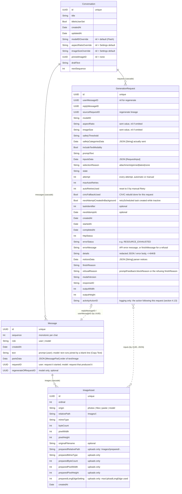
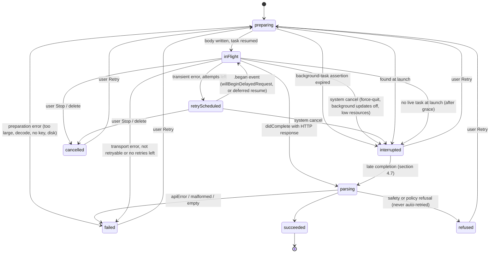

# ImageGen for iPhone: Design

Status: v1 design, ready for implementation
Date: 2026-10-15
Reference behavior: `doc/openwebui_gemini_filter.py` (OpenWebUI "Gemini Native Image Gen & Edit Pipe" v2.0.0)
Companion: `doc/IMPLEMENTATION_PLAN.md` (milestones, agent tasks, verification steps). Both documents and the reference pipe live in `doc/`.

---

## 1. Purpose and scope

### 1.1 Purpose
ImageGen is a personal iPhone app. It does what the OpenWebUI Gemini pipe does, in a native app: you chat to generate and edit images through the Gemini REST API (`generateContent`), using your own Gemini API key. A request carries only the selected image(s) and the latest instruction. Results arrive as images plus optional Markdown text, and stay in a list of saved chats on the device.

### 1.2 Goals (v1)
1. **Same results as the pipe.** Given the same inputs, the request body matches the pipe's except for the deliberate deviations in section 2.6.
2. **Gemini 3.1 Flash Image (`gemini-3.1-flash-image`) is the default model and always available.** Each chat can switch to other image models.
3. **Aspect ratio and resolution are configurable, with defaults of 16:9 and 2K.** Global defaults live in Settings. Each chat can override them from the composer. Every request records the values it used, so Regenerate reproduces them.
4. **Images can be attached from Photos, Files and the clipboard.** Several attachments per message are allowed. Uploads are downscaled to a long edge you set, and HEIC is converted to JPEG.
5. **"Edit from here".** You can pin any earlier image as the base for the next message.
6. **Requests survive the app going to the background.** They run on a background `URLSession`, and a local notification fires when one finishes while the app isn't active.
7. **Saved images are byte-for-byte what the API returned.** This applies to Photos, Files, Share and Copy.
8. **Saved chats.** Chats persist on the device (SwiftData plus image files) and can be reopened, renamed and deleted.
9. **Every step is logged, for debugging.** Before each action the app logs, in terse natural language, what it is about to do and every operative parameter; afterwards it logs the result. A Developer menu (`hammer`) on the chat list and the chat screen shows the last action, the last error or the full log, and clears it. The log stays on the device and never holds the API key, headers or image data (sections 3.10, 4.13).

### 1.3 Non-goals (v1)
These were declined or deferred:
- Camera capture, a share extension, and drag-and-drop.
- Thinking controls or displaying thoughts. `thinkingConfig` is never sent, and thought parts are always dropped.
- Google Search grounding.
- A usage, token or cost readout.
- Full-history (multi-turn) context. The app never sends earlier turns, so `thoughtSignature` handling isn't needed.
- iPad, Mac Catalyst, App Store or TestFlight distribution, iCloud sync, and widgets.
- Streaming (`streamGenerateContent`) and the Interactions API.
- The Files API. Everything goes inline, within the 20 MB budget.
- Batch generation, and asking for more than one output image.
- Editing a sent message in place (in its bubble). Edit and Resend and a refused reply's Edit load the text into the composer and send a new turn (section 3.6). In-place editing is a possible future enhancement.

### 1.4 Platform and constraints
- iOS 26.0 minimum, iPhone only, portrait plus landscape (not upside-down). Built against the iOS 26+ SDK with Xcode 26.x or later.
- Swift 6 language mode with complete strict concurrency, SwiftUI with Observation, SwiftData, and Liquid Glass.
- No third-party dependencies.
- Installed from Xcode with the user's **paid Apple Developer Program** team. The first install is a one-time Product › Run from Xcode; the provisioning profile lasts a year (see section 11, R9).
- Built and verified by Claude Code agents using XcodeGen (`project.yml`), Swift Testing, and the simulator, then installed on the device.

---

## 2. Matching the pipe's behavior

This section is the normative contract. Every rule is implemented in pure, unit-tested code: `InputSelector`, `RequestBodyWriter` and `ResponseParser`.

### 2.1 What the pipe does (summary)
- The pipe takes the text of the latest user message and the latest user message's **last** image. If there isn't one, it walks the earlier messages from newest to oldest and takes the **last** image of the first message that has any images. That can be an assistant output or a user upload.
- It sends a **single user turn**: `parts = [inlineData(image)?, text?]`. The image comes first. The text part is omitted when it's empty.
- It sends `generationConfig.responseModalities = ["TEXT","IMAGE"]`, with no `imageConfig` and no `thinkingConfig`.
- It sends `safetySettings` with one threshold applied to five categories: HARASSMENT, HATE_SPEECH, SEXUALLY_EXPLICIT, DANGEROUS_CONTENT and CIVIC_INTEGRITY. The default threshold is `BLOCK_NONE`.
- It sends `POST …/v1beta/models/{model}:generateContent?key=…` with a 300 s timeout and no retries.
- **Responses:** for a non-200 status it shows `Error {status}: {body}`. On success it renders `candidates[0].content.parts` in order: text as-is, `inlineData` as an embedded image (falling back to `image/jpeg` when no MIME type is given). With no parts it shows `"No content returned by the model."`. When the JSON lacks the expected keys, it shows the pretty-printed JSON.

### 2.2 Choosing input images (the `InputSelector`)
These inputs are evaluated when the user taps Send:
- `attachments`: the composer tray items in the `.ready` state, in tray order. Send can't be tapped while any tray item is still importing or preparing, or has failed (see "Send is enabled when" below), so at send time every tray item is ready and every attachment shown is sent.
- `pin`: `Conversation.pinnedImageID`
- `history`: the chat's messages, earlier than the new one

Rules, applied in order:
1. **Attachments.** If there is at least one, send **all** of them, in tray order. The reason is recorded as `.attachments`. The pin is cleared even though it wasn't used.
2. **Pin.** Otherwise, if a pin is set and its `ImageAsset` still exists, send that one image. The reason is `.pinned`, and the pin is cleared because it's one-shot.
3. **Most recent image.** Otherwise, walk `history` by descending `sequence`. Skip **model** messages whose request state is not `succeeded`: pending, failed, refused, cancelled and interrupted replies carry no images anyway, and skipping them keeps the rule explicit. User messages are always eligible, whatever happened to their reply, as in the pipe (where an error reply has no image, so the walk reaches the user's upload). In the first message with at least one `ImageAsset`, take the image with the **highest `ordinal`**. Because `ordinal` follows response-part order for model messages and tray order for user messages (section 4.3), this is the last image in that message, the same image as the pipe's `images[-1]`. User and model messages count the same. Image parts that failed to decode were never stored (section 2.7), so they are never candidates. The reason is `.latest`.
4. **None.** Otherwise, send no image. The reason is `.noImage`, stored as `"none"` (text-to-image). This happens only when the chat holds no image yet, which in practice is the first turn of a new chat.

At every turn, either new attachments, the pinned image or the latest image in the chat is sent along with that turn's text; to generate from text only, start a new chat. This is the pipe's behavior. When rule 3 applies, the composer shows an "Editing latest image" chip (section 3.5). The chip is purely informational: it shows which image will be sent and can't be dismissed.

**Send is enabled when all of these hold:**
- no tray item is still importing or preparing (the composer shows "Preparing images…" next to the disabled Send button);
- no tray item has failed. A failed item shows ⚠︎ with its reason, and Send stays disabled until the user removes it, so an attachment is never dropped silently;
- the trimmed text is non-empty, or there is at least one ready attachment; and
- the chat has no request in flight.

Sending an image with no text is allowed only from attachments, which matches the pipe's "image without text" case. Sending only the reused previous image with no text is not allowed.

The request body never has an empty `parts` list. `RequestBodyWriter` throws `emptyParts` if it gets no images and no text, which mirrors the pipe's "Could not extract any content from the conversation" error. The Send rules above make this unreachable from the UI.

### 2.3 Extracting the text
- `promptText` is the composer text, trimmed of leading and trailing whitespace and newlines. Inner newlines are kept.
- When `promptText` is empty, there is no text part.

### 2.4 Request construction (the `RequestBodyWriter`)
- **Endpoint:** `POST https://generativelanguage.googleapis.com/v1beta/models/{modelID}:generateContent`
- **Headers:**
  - `Content-Type: application/json`
  - `Accept: application/json`
  - `x-goog-api-key: <key>`
  - The key is **never** put in a query parameter.

Body (camelCase; shown in a readable key order). Key order has no meaning to the API. The writer encodes with `.sortedKeys` so the bytes are deterministic, and golden tests compare structurally. Array order (parts, safety categories) is significant and is kept:

```json
{
  "contents": [{
    "role": "user",
    "parts": [
      {"inlineData": {"mimeType": "image/jpeg", "data": "<base64 #1>"}},
      {"inlineData": {"mimeType": "image/png",  "data": "<base64 #2>"}},
      {"text": "<promptText>"}
    ]
  }],
  "generationConfig": {
    "responseModalities": ["TEXT", "IMAGE"],
    "imageConfig": {"aspectRatio": "16:9", "imageSize": "2K"}
  },
  "safetySettings": [
    {"category": "HARM_CATEGORY_HARASSMENT",        "threshold": "BLOCK_NONE"},
    {"category": "HARM_CATEGORY_HATE_SPEECH",       "threshold": "BLOCK_NONE"},
    {"category": "HARM_CATEGORY_SEXUALLY_EXPLICIT", "threshold": "BLOCK_NONE"},
    {"category": "HARM_CATEGORY_DANGEROUS_CONTENT", "threshold": "BLOCK_NONE"},
    {"category": "HARM_CATEGORY_CIVIC_INTEGRITY",   "threshold": "BLOCK_NONE"}
  ]
}
```

**Parts**
- Images come first, in selection order, and the text comes last. This matches the pipe's image-then-text order.
- `mimeType` is the type of the bytes actually sent (section 4.8).

**`responseModalities`**
- Default `["TEXT","IMAGE"]`, matching the pipe. The live smoke test settled R3 on 2026-10-16: 2K is honored with TEXT+IMAGE, so the default stays (section 11).
- Advanced setting "Request text alongside images" (`includeTextModality`, default on). Turning it off sends `["IMAGE"]`.
- **R3 decision (user, 2026-10-16):** if the live smoke test confirms that `["TEXT","IMAGE"]` caps output at 1K, the default switches to `["IMAGE"]` (the setting's default becomes off). The Advanced toggle still lets the user turn text back on. Until that's confirmed, the default stays `["TEXT","IMAGE"]`.

**`imageConfig`**
- Always sent for models whose capability says they support it.
- The `imageSize` key is left out for models without size support (section 2.5).
- Values are exact API strings: `"512"`, `"1K"`, `"2K"`, `"4K"` (uppercase K; 512 is sent as the bare string `"512"`, never `"512px"` or `"0.5K"`).

**Not sent:** `thinkingConfig` (matches the pipe; thinking level is documented as controllable only for 2.1, 3.1 Flash and 3.1 Flash Lite, and Flash defaults to `minimal`), `candidateCount`, `tools` and `systemInstruction`.

**`safetySettings`**
- The five categories above, all at the global threshold.
- `HARM_CATEGORY_CIVIC_INTEGRITY` is deprecated in the API enum. It's kept for parity, with an automatic fallback:
  1. If a request fails with 400 `INVALID_ARGUMENT` and the message mentions `CIVIC_INTEGRITY`, rebuild the body without it and retry once.
  2. Persist the `omitCivicIntegrity = true` flag through `AppSettings` on the main actor (section 5), so the next send from an already-open chat resolves four categories at once.
  3. Record the categories actually sent on the request, and set `civicFallbackUsed` on it.

**Thresholds:** `BLOCK_NONE` (default), `BLOCK_ONLY_HIGH`, `BLOCK_MEDIUM_AND_ABOVE`, `BLOCK_LOW_AND_ABOVE`. These are the pipe's set; `OFF` isn't offered.

**How the body is written.** The body is streamed to a file (`Requests/<id>/body.json`):
1. The JSON envelope and the text are encoded with `JSONEncoder` (correct escaping).
2. The image bytes are base64-encoded in 48 KiB chunks (a multiple of 3), straight from the prepared files.

No full-body `String` or `Data` is ever built in memory. The exact body size is computed before writing: envelope bytes plus `4*ceil(n/3)` per image.

### 2.5 Models, capabilities and coercion
`ModelCatalog` is a static table. Every catalog model is enabled by default and offered in the per-chat model switch, filtered by what the key can actually use (`models.list`, below). Settings lets you hide any catalog model except Flash, and add custom IDs (section 11, Q1).

| Model ID | Display name | Role | Aspect ratios | `imageSize` | High-fidelity inputs (documented) | Notes |
|---|---|---|---|---|---|---|
| `gemini-3.1-flash-image` | Gemini 3.1 Flash Image | **Default, mandatory, can't be removed** | all 14 | 512, 1K, 2K, 4K | up to 10 objects / 4 characters | validated behavior |
| `gemini-3-pro-image` | Gemini 3 Pro Image | optional, on by default (shown if available) | 10 standard (no 1:4, 4:1, 1:8, 8:1) | 1K, 2K, 4K | up to 6 objects / 5 characters (another passage says 5) | replaces the pipe's `gemini-3-pro-image-preview` |
| `gemini-nano-banana-2.1` | Nano Banana 2.1 | optional, on by default (shown if available) | all 14 | 1K, 2K, 4K | up to 10 objects / 4 characters | newest; Google's recommended model |
| `gemini-3.1-flash-lite-image` | Gemini 3.1 Flash Lite Image | optional, on by default (shown if available) | 10 standard | 1K only | not documented | documented limits; the coercion makes every size 1K |
| `gemini-2.5-flash-image` | Gemini 2.5 Flash Image | optional, on by default (shown if available) | 10 standard | none (the key is omitted; one fixed size per ratio, about 1 MP) | up to 3 | older model; access may be limited to existing users |
| `gemini-3-pro-image-preview` | Gemini 3 Pro Image (preview) | legacy alias: its toggle is on by default, but it's offered in the model menu only after `models.list` has listed it (never before the first check) | as 3 Pro | as 3 Pro | as 3 Pro | legacy alias |
| any custom ID | the ID itself | user-added | all 14 | 1K, 2K, 4K | unknown | unknown capabilities; API errors are shown as-is |

- **All 14 aspect ratios:** 1:1, 1:4, 4:1, 1:8, 8:1, 2:3, 3:2, 3:4, 4:3, 4:5, 5:4, 9:16, 16:9, 21:9. **The 10 standard ratios** are the same without 1:4, 4:1, 1:8 and 8:1.
- **High-fidelity soft limit** (`ModelCapability.highFidelityInputLimit`, one number per model, used only for the soft tray warning in section 4.8): Flash 10, 2.1 10, 3 Pro and its preview alias 5 (the lower of the two documented values), 2.5 Flash Image 3. Flash Lite and custom IDs have no soft limit (the value is 14, the hard cap), so no warning appears.
- **Effective settings** for a request are resolved by `GenerationSettingsResolver`, in this order:
  1. Model: `conversation.modelIDOverride` if that model is still enabled in Settings › Models (a catalog model whose toggle is on, or a custom ID that hasn't been removed); otherwise the default model (Flash). An override that falls back this way is reported as a coercion: the Model pill shows "3.1 Flash" with the caution glyph, and the request records Flash. The override itself is kept, so turning the model back on restores it. Flash can't be disabled, so the fallback always exists.
  2. Aspect ratio: `conversation.aspectRatioOverride`, or `settings.defaultAspectRatio` (default `16:9`, landscape widescreen).
  3. Size: `conversation.imageSizeOverride`, or `settings.defaultImageSize` (default `2K`).
  4. Coerce to the model's capability:
     - aspect ratio not supported: use `16:9` if supported, else `1:1`;
     - size not supported: use the nearest supported size, preferring the larger (512 becomes 1K; for a 1K-only model everything becomes 1K);
     - model without `imageSize` support: leave the key out.
  5. When coercion changes a value (the model, aspect ratio or size), the composer pill shows it with a caution glyph, and the request records the coerced value.
- **Runtime validation (`ModelAvailabilityService`):**
  - Calls `GET /v1beta/models?pageSize=1000` with the header key, and follows `nextPageToken` if one is returned.
  - Runs when the key is saved, on foreground at most once every 24 h, and when you pull to refresh in the Settings › Models screen.
  - Caches `{id: supportsGenerateContent}` and a timestamp.
  - The per-chat model menu offers every model that is enabled in Settings and that the key can use. A model that isn't listed is labeled "Not listed for this key" in Settings › Models and left out of the model menu. Before the first successful check (availability "Unknown — not checked"), enabled models are offered, except the legacy preview alias, which needs a listing (it's offered only once `models.list` returns it). Flash stays selectable even if unlisted, with a warning banner, because listing can lag.
  - The catalog IDs other than Flash haven't all been confirmed against a real key. They stay validated at runtime: by this `models.list` filter, and by the 404 handling below.
  - A 404 at request time is reported as "Model not found or retired" with a button that opens Settings › Models.

### 2.6 Deliberate deviations from the pipe
| Area | Pipe | App | Why |
|---|---|---|---|
| Auth | `?key=` query | `x-goog-api-key` header | keeps the key out of URLs and logs |
| `imageConfig` | not sent (API defaults: 1K, model picks the ratio) | always sent; default 16:9 / 2K; configurable | user requirement |
| Attachments | last image of the latest message only | all attachments, in order | user requirement |
| Edit base | latest image only | pinned image takes priority over latest | user requirement |
| Response modalities | always `["TEXT","IMAGE"]` | `["TEXT","IMAGE"]` by default, matching the pipe; if the live smoke test confirms the 1K cap, the default becomes `["IMAGE"]` and this row is updated to say so (section 2.4, section 11 R3) | keeps the 2K default honored |
| Pro model ID | `gemini-3-pro-image-preview` | `gemini-3-pro-image` (preview only if listed) | the preview ID's shutdown date has passed |
| Transport | synchronous, 300 s | background `URLSession`, 300 s idle timeout, 30 min overall timeout, limited automatic retries (section 6, Retry policy) | must finish in the background |
| CIVIC_INTEGRITY | always sent | sent, with an automatic one-time fallback | the category is deprecated |
| Errors | Markdown text in the chat | structured error card, raw JSON under Details | native UI |
| Safety refusals | no special handling: a prompt-level block (no `candidates`) or a refused candidate without `content.parts` fails the key lookup, so the raw JSON is dumped; a refused candidate that still has text parts shows that text | the reply shows only "Request refused: <reason>" with Retry, Edit and New Chat (section 3.4); `finishMessage`, any returned text and the redacted JSON are under Details in the reply's Info sheet (section 2.7 rules 3 and 6) | user requirement (2026-10-16): the reason is what matters, and the filters are inconsistent, so the next step is retry, edit or a new chat |
| Thought parts | rendered if present | always dropped | thinking display is a non-goal |
| Upload bytes | the uploaded image's data URL is sent as-is | uploads are always re-encoded (downscaled to the max long edge, HEIC→JPEG, EXIF/GPS stripped; section 4.8). Model outputs reused as inputs are still sent as original bytes | size budget, privacy, user requirement |
| Text parts | concatenated with no separator; only the whole output is stripped | concatenated with no separator (verbatim); each text run between images is trimmed at its two ends only | the app renders text runs and images as separate blocks, so whitespace at a block edge has no visible effect; text inside a run is never changed |
| Undecodable image part | embedded as-is, so it also becomes the next edit base | dropped, with the notice "1 image could not be decoded"; it's never stored, so §2.2 rule 3 skips it and the next edit uses the previous real image | bytes that aren't an image can't be displayed or saved, and re-sending them would most likely fail the next request; confirmed by the user (section 11, Q3) |
| Success check | `status == 200` | any 2xx | equivalent in practice |

### 2.7 Parsing responses (the `ResponseParser`)
**Inputs:** the HTTP status and the response body file. **Output:** a `ParsedOutcome` (Sendable):
- `.success(parts: [OutputPart], finishReason, notices, modelVersion, responseId)`, where `OutputPart` is `.text(String)` or `.image(StoredOutputImage)`. `StoredOutputImage` is `{fileURL, mimeType, byteCount, pixelWidth, pixelHeight}`: the parser writes each decoded image straight to the directory the caller passes in, which is always `Requests/<requestID>/out-<attempt>/` (section 4.4), and `GenerationService` moves the files into `Images/<conv>/` (see Memory below). No image `Data` is held in the outcome. `notices` are short user-facing strings (for example "1 image could not be decoded"); they're stored on the request (`noticesData`, section 4.3) so they survive a relaunch.
- `.refused(reason, message?, notices, details)`: a safety or policy refusal. `reason` is the API's string, verbatim, and is stored as `GenerationRequest.refusalReason`; `message` is `finishMessage` when present, and is stored as `GenerationRequest.errorMessage` (section 4.3), which the reply's Info sheet shows as "Message: …" (section 3.6). It never appears on the card.
- `.empty(finishReason?, details)`
- `.apiError(httpStatus, status?, message, details)`
- `.malformed(details)`

Rules, in order:
1. **Status not in 200…299.** Try to decode `{"error":{"code","message","status","details"}}`.
   - The result is `.apiError`.
   - If the body isn't that JSON, the message is the first 2 KB of the body as UTF-8, matching the pipe's `Error {status}: {text}`.
   - `details` holds the full body, truncated to 64 KB.
2. **The body isn't valid JSON, or doesn't decode as a response.** The result is `.malformed`, with the first 64 KB of the body.
3. **`promptFeedback.blockReason` is set** (for example `SAFETY`, `OTHER`, `BLOCKLIST`, `PROHIBITED_CONTENT`, `IMAGE_SAFETY`). The result is `.refused(reason: blockReason)`.
4. **`candidates` is missing or empty.** The result is `.empty(nil)`.
5. **Otherwise, take `c = candidates[0]`** (the pipe uses only the first candidate) and filter `c.content?.parts` to drop every part where `thought == true`. For each remaining part, in order:
   - `text` parts: consecutive text parts are concatenated **verbatim, with no separator**, into one text run, as the pipe does. A run ends at an image part or at the end of the parts. Each run is trimmed of leading and trailing whitespace at its two ends only, and a run that is empty after trimming is dropped. Text inside a run is never changed, so a sentence, list or code fence that Gemini splits across parts comes back intact. Each remaining run becomes one `.text`.
   - `inlineData` becomes `.image`. Use `Data(base64Encoded:options:.ignoreUnknownCharacters)`. The MIME type is `inlineData.mimeType`, defaulting to `image/jpeg` as the pipe does. If the bytes don't decode as an image (`CGImageSourceGetCount == 0`), drop the part and add a "1 image could not be decoded" notice. This is a deliberate deviation (section 2.6): the bytes are never stored, so the latest-image rule (§2.2 rule 3) never picks them.
   - Other part kinds are ignored.
6. **Refused candidate.** If no `.image` survived step 5, and `c.finishReason` is present and is **not** one of {`STOP`, `MAX_TOKENS`, `FINISH_REASON_UNSPECIFIED`}, the result is `.refused(reason: finishReason, message: finishMessage)`.
   - This explicitly includes `IMAGE_SAFETY`, `IMAGE_PROHIBITED_CONTENT`, `IMAGE_OTHER`, `IMAGE_RECITATION`, `PROHIBITED_CONTENT`, `SAFETY`, `BLOCKLIST`, `SPII`, `RECITATION`, `NO_IMAGE`, `OTHER`, `ESCALATION` and `PUP_LIMITED_DISABLED`.
   - It is forward-compatible: any finish reason the app doesn't recognize is a refusal too, and its string is shown verbatim.
   - The boundary is the surviving image: a candidate with at least one decodable image is `.success` whatever its finish reason (rule 8, for example "Finished: IMAGE_SAFETY" as a footnote), while a candidate whose only image parts were undecodable and dropped in step 5 is `.refused` when its finish reason is a refusing one (the "could not be decoded" notice is kept).
   - It applies even when the candidate carried text parts. Those text runs are **not** shown in the turn and don't become reply parts; they stay in the request record (in `details`, the redacted response JSON) and are shown under Details in the reply's Info sheet.
   - `PUP_LIMITED_DISABLED` means the API account itself is limited or disabled for Prohibited Use Policy violations. It is still `.refused` and titled like every refusal, but its card has no Retry and a one-line note that retrying won't help (section 3.4).
7. **No parts left** (and not refused: the finish reason is `STOP`, `MAX_TOKENS`, `FINISH_REASON_UNSPECIFIED` or missing). The result is `.empty(finishReason)`, shown as "No content returned by the model." plus the raw reason.
8. **At least one part.** The result is `.success`. If `finishReason` is anything other than `STOP`, or is missing, it's shown as a footnote (for example "Finished: MAX_TOKENS"). A text-only success, with no image, is possible only when the finish reason is `STOP`, `MAX_TOKENS`, `FINISH_REASON_UNSPECIFIED` or missing (any other reason is rule 6); it gets a "No image returned" badge. The badge isn't stored as a flag: the UI derives it from the stored reply (state `succeeded` and no image parts in `partsData`), so it survives a relaunch.

Refusals are never retried automatically: no `RetryPolicy` retry and no CIVIC fallback is triggered by a refusal (section 6). Retrying is the user's choice, from the card.

**Details text.** For every terminal outcome the parser makes a **redacted** pretty-printed JSON copy of the response:
- Every `inlineData.data` is replaced with `"<N bytes image/jpeg>"`, and every `thoughtSignature` with `"<redacted>"`.
- It's stored on the request (capped at 64 KB) and shown under "Details" in the error card and in the reply's info sheet (for a refusal, only in the info sheet, section 3.4).

This is the native counterpart of the pipe's JSON dump.

**Memory.** The parser decodes from a memory-mapped body (`Data(contentsOf:options:.mappedIfSafe)`) with `Decodable` structs where `inlineData.data` is a `String`. It decodes each image and writes it at once to the output directory the caller passed in (`Requests/<id>/out-<attempt>/`, on the same volume, so `GenerationService`'s move into `Images/<conv>/` is a rename), then releases it. The Janitor never touches the request folder of a non-terminal request (section 4.4), so these files are safe until they're moved and saved. Nothing keeps the base64 strings or decoded bytes after parsing.

---

## 3. UX spec

### 3.1 Structure
- `NavigationStack` at the root:
  - the chat list is the root view;
  - `navigationDestination(for: Conversation.ID.self)` opens a chat;
  - Settings is a sheet;
  - the image viewer is a `fullScreenCover`.
- Standard bars get Liquid Glass automatically. Custom glass is used only in the composer and on viewer controls, never on message content.
- Dark mode, Dynamic Type (up to accessibility sizes, with the composer pills wrapping) and VoiceOver labels are supported for every icon button.

### 3.2 Onboarding and API key
This screen appears when the Keychain has no key, at first launch or after the key is removed.
- Title "Connect Gemini". A short explanation. The text "Get a key at aistudio.google.com/apikey", shown as selectable text, not a web view.
- A `SecureField` with a paste-friendly reveal toggle, and a **Validate and Save** button (`.glassProminent`).
- Validation calls `GET /v1beta/models?pageSize=1000` with the header key over an ephemeral session, with a 20 s timeout:

| Result | What the user sees |
|---|---|
| 200 | Save to the Keychain, cache the model availability, go to the chat list. If `gemini-3.1-flash-image` is missing from the list or lacks `generateContent`, show a non-blocking warning: "Your key doesn't list Gemini 3.1 Flash Image; generation may fail." |
| 400 with `API_KEY_INVALID`, or 401/403 | "Key rejected" plus the API message. Not saved. |
| Network error or 5xx | "Couldn't reach Google", with the choices **Retry** and **Save Anyway**. |

- The key is never displayed after saving. Settings shows only its last 4 characters.

### 3.3 Chat list
- The large title is "Chats".
- **Toolbar:** a Settings button (`gearshape`, leading); trailing, the Developer menu (`hammer`, section 3.10) and then the New Chat button (`square.and.pencil`, primary), so New Chat stays the trailing-most item. New Chat creates an empty conversation and pushes it onto the stack.
- **New Chat row:** the first row is not a chat. It shows a tinted `square.and.pencil` square where a chat's thumbnail would be and "New Chat" in the title's place, and a tap does exactly what the toolbar's New Chat button does. It has no swipe actions and no long-press rename. It isn't shown in the empty state, which has its own New Chat button.
- **Chat rows**, below it, sorted by `updatedAt` descending:
  - a 44 pt rounded thumbnail of the chat's latest image, or a placeholder glyph;
  - the title (one line);
  - a subtitle with the last prompt snippet (one line, secondary);
  - a relative timestamp;
  - an activity indicator when the chat has a request in flight, and a red dot when its latest request is `failed` or `refused` (both need the user's attention; `cancelled`, `interrupted`, `empty` and succeeded requests get no dot).
- **Swipe actions:** trailing **Delete** (destructive, with a confirmation alert: "Delete chat and its N images?", or "Delete this chat?" when it has none) and leading **Rename**, which edits the title in place in the row.
- **Long-press a row** to edit its title in place (no context menu; a tap still opens the chat). Delete is on the trailing swipe only.
- **Rename in place:** the row's title becomes a focused text field with its text selected, plus ✕ and ✓. Return or ✓ saves; ✕ or moving focus away cancels; an unchanged name does nothing. An empty name reverts to the automatic title (`titleIsUserSet = false`), as it does in the Rename alert (section 3.4).
- **Automatic title:** the first 48 characters of the first prompt, trimmed at a word boundary. "New Chat" until the first send.
- **Empty state:** a `ContentUnavailableView` reading "No chats yet", with a New Chat button.
- Empty conversations (no messages) are deleted automatically when you leave them.

### 3.4 Chat screen
**Navigation bar**
- The inline title is the chat title. Tapping it opens the Rename alert; long-pressing it edits the title in place in the navigation bar (a glass capsule with the text selected, ✕ and ✓; Return or ✓ saves, ✕ or moving focus away cancels).
- Trailing: the Developer menu (`hammer`, section 3.10), then the existing chat menu, which offers Rename, "Chat settings…" (the model, aspect and resolution overrides, the same as the pills) and Delete chat.

**Transcript**
- A `ScrollView` with a `LazyVStack`, `.defaultScrollAnchor(.bottom)`, and `.scrollDismissesKeyboard(.interactively)`.
- On open and on a new message, it scrolls to the bottom. A "jump to latest" glass button appears when you're scrolled more than one screen up.

**User message**
- A right-aligned bubble tinted with the accent color.
- Attachments appear above the text as a grid: one image at full bubble width; two to four in a 2-column grid; five or more in a 3-column grid. Each thumbnail keeps its stored aspect ratio.
- When the input came from the pin or the latest image rather than attachments, a small secondary caption under the bubble says "Edited from pinned image" or "Edited latest image", with a 20 pt thumbnail.

**Model reply**
- Left-aligned, with no bubble background.
- Parts render in the order returned:
  - images at full content width, with a 12 pt corner radius and placeholder frames sized from the stored pixel dimensions, so layout doesn't jump;
  - text as rendered Markdown (section 4.12).
- Under the reply, a metadata line in caption style, secondary color: `3.1 Flash · 16:9 · 2K · 2752×1536`.
  - The requested values come from the request record. The pixel size is the actual size of the first output image.
  - **Size check (R3).** The size class is judged by **pixel count**, not the long edge, because extreme ratios have long edges outside the usual range (1:8 at 1K is 384×3072). The nominal sizes are 512 ≈ 0.26 MP, 1K ≈ 1.05 MP, 2K ≈ 4.2 MP and 4K ≈ 16.8 MP. If the actual megapixels are more than a factor of 1.5 away from the requested class, it shows a ⚠︎ marker naming the nearest class, for example "returned 1K".
  - **Aspect check (R4).** If the actual width/height differs from the requested ratio by more than 3%, it shows a ⚠︎ "returned 1:1"-style marker, naming the nearest of the 14 ratios.
  - This is how the app checks reports R3 and R4.
- Regenerated replies show a header: "↻ Regenerated · “prompt snippet…”".

**Pending reply**
- A placeholder card shaped to the requested aspect ratio, with a subtle shimmer, and the label "Generating… 0:23". Elapsed time comes from `TimelineView(.periodic)` and `request.startedAt`.
- The label under the timer depends on the state:
  - `preparing`: "Preparing images…";
  - `inFlight` or `retryScheduled` while `ConnectivityMonitor` reports no usable network path and the app is in the foreground: "Waiting for network" (section 4.6; the background session itself waits silently);
  - `retryScheduled` with a retry created in the foreground: "Retrying in 2 s (attempt 2/3)", a countdown to `nextAttemptAt`;
  - `retryScheduled` with a retry created while the app was in the background: "Retry scheduled (attempt 2/3)", with no countdown, because iOS may defer such a task (section 6, Retry policy);
  - `inFlight` and `parsing`: no extra label.
  - The attempt counter is `autoRetriesUsed + 1` of `maxAutoRetries + 1`.
- A **Cancel** button.

**Failed, refused, empty, cancelled or interrupted reply**
- An inset card with an SF Symbol, a title, a one-line message (where the table gives one) and the buttons from the table below. **Retry** is a new attempt of the same request (section 6, Regenerate vs Retry). **Details** opens a sheet with monospaced, selectable redacted JSON or the error body, and a Copy button. Regenerate, Info and Delete are always in the reply's long-press menu (section 3.6), not on the card.
- This table is the single source for card glyphs, titles, message lines and buttons, including the refused variants for a deleted user message; `ReplyPresentationTests` check every row exactly. `<…>` is filled from the request record.

| Outcome (section 6 row) | SF Symbol | Title | Message line | Card buttons |
|---|---|---|---|---|
| Refused: prompt or output, any reason except PUP (#12) | `hand.raised` | "Request refused: <reason>" (for example "Request refused: IMAGE_OTHER") | none | Retry, Edit, New Chat |
| Refused, as above, but the originating user message was deleted (#12) | `hand.raised` | "Request refused: <reason>" | none | Retry, New Chat |
| Refused: `PUP_LIMITED_DISABLED` (#13) | `hand.raised` | "Request refused: PUP_LIMITED_DISABLED" | "This API account is limited by Google; retrying won't help." | Edit, New Chat |
| Refused: `PUP_LIMITED_DISABLED`, originating user message deleted (#13) | `hand.raised` | "Request refused: PUP_LIMITED_DISABLED" | "This API account is limited by Google; retrying won't help." | New Chat |
| Empty (#15) | `photo.badge.exclamationmark` | "No content returned by the model." | "Finished: <finishReason>", or nothing when there's none | Retry, Details |
| No API key (#1) | `key` | "No API key" | "Add a key in Settings." | Settings |
| Key rejected (#2) | `key` | "Key rejected (<code> <STATUS>)" | the API message | Settings, Details |
| Bad config (#3) or billing/region (#5) | `exclamationmark.triangle` | "Error <code> <STATUS>" | the API message; for #3 also "Sent: <aspect> · <size>" | Details |
| Out of credits (#6) | `creditcard` | "Out of credits" | the API message | Details |
| Model not found (#7) | `questionmark.circle` | "Model not found or retired: <modelID>" | the API message | Open Models, Details |
| Rate limit or server error after the last retry (#8, #9) | `exclamationmark.triangle` | "Error <code> <STATUS>" (for example "Error 429 RESOURCE_EXHAUSTED") | the API message | Retry, Details |
| Timed out (#10, #11) | `clock.badge.exclamationmark` | "Timed out" | "No response within <n> min." | Retry, Details |
| Other network error after retries | `wifi.exclamationmark` | "Network error" | the `URLError` code name | Retry, Details |
| Malformed or unexpected body (#16, #33) | `doc.questionmark` | "Unexpected response" | "The server didn't return a Gemini response." | Retry, Details |
| Request too large (#19) | `photo.stack` | "Images too large to send together (<N> MB)" | "Remove some or lower the max size in Settings." | none |
| Disk full (#27) | `externaldrive.badge.exclamationmark` | "Not enough storage to save the result" | "Free some space, then retry." | Retry |
| Cancelled | `stop.circle` | "Cancelled" | none | Retry |
| Interrupted (#25) | `bolt.horizontal.circle` | "Interrupted: the app was closed before the result arrived" | "iOS stopped the request (for example after a force-quit). Retry to send it again." | Retry |

**Refused replies** (section 2.7 rules 3 and 6). The card shows simply "Request refused: <reason>", with the reason string verbatim, including reasons the app doesn't recognize. Nothing else is on the card: `finishMessage` and any text the model returned are under Details, reached through **Info** in the reply's long-press menu (section 3.6); Details is not a card button. The expected next step is one of the three buttons, in this order:
- **Retry** re-runs the same recorded request in place, with the same inputs and settings (section 6, Regenerate vs Retry). The safety filters are inconsistent and sometimes spurious, so retrying an unchanged request often succeeds. A refusal is never retried automatically.
- **Edit** is Edit and Resend (section 3.6) of the user message that produced this reply (for a regenerated reply, the user message of the request it regenerated): it loads that message's text into the composer, clones its attachments, restores the pin to the input image if the request used `.pinned` or `.latest`, and focuses the text field, so the user changes the instructions and sends. It's hidden if that user message has been deleted (the "originating user message deleted" rows of the table above).
- **New Chat** creates a new empty conversation and navigates to it, the same as the chat list's New Chat (section 3.3), to pursue a new idea. The new chat replaces the current one on the navigation stack, so Back returns to the chat list; the refused chat is kept.

A refused reply has no images, so the latest-image rule skips it (section 2.2 rule 3).

### 3.5 Composer
The composer sits at the bottom in `.safeAreaBar(edge: .bottom)`, inside a `GlassEffectContainer`. From top to bottom:

1. **Context chips** (conditional, single row):
   - Pin chip: `[thumb] Editing from pinned image ✕`. ✕ unpins, so the send falls back to the latest image (rule 3). When attachments are present, it dims and reads "Pinned image replaced by attachments".
   - Implicit base chip (when rule 3 would apply): `[thumb] Editing latest image`. It's informational only, with no ✕: it shows which image will be sent and can't be dismissed. Text-only generation needs a new chat (section 2.2).
2. **Attachment tray** (conditional): a horizontal scroll of 56 pt thumbnails.
   - Each has ✕, a spinner while importing or preparing, a ⚠︎ on failure (tap to see why, with a Remove button), and a long-press menu to reorder (Move Left, Move Right) or Remove.
   - While any item is importing or preparing, or has failed, Send is disabled (section 2.2). The caption then reads "Preparing images…" or "Remove the image that couldn't be prepared".
   - The trailing caption otherwise shows the count and the budget, for example "3 images · 6.1 MB of 19 MB". Above the model's high-fidelity soft limit (section 2.5) it adds "Best results with up to N images on <model>".
3. **Settings pills** (one row of compact glass capsules, each a `Menu`):
   - **Model** ("3.1 Flash ▾"): every enabled model the key can use (all catalog models by default); models `models.list` doesn't list are left out (section 2.5).
   - **Aspect** ("16:9 ▾"): grouped sections:
     - Landscape: 16:9, 21:9, 3:2, 4:3, 5:4
     - Square: 1:1
     - Portrait: 9:16, 2:3, 3:4, 4:5
     - Extreme: 4:1, 8:1, 1:4, 1:8
     Ratios the model doesn't support are hidden. The first item is "Default (<value>)", where `<value>` is the **current** `settings.defaultAspectRatio`: "Default (16:9)" out of the box, "Default (1:1)" after the global default is changed to 1:1. If the current model doesn't support the default, the item shows the coerced value with the caution glyph, for example "Default (16:9 ⚠︎)".
   - **Resolution** ("2K ▾"): 512 px, 1K (~1 MP), 2K (~4 MP), 4K (~16 MP), filtered by the model. The first item is "Default (<value>)" from the current `settings.defaultImageSize`: "Default (2K)" out of the box, with the same coerced-value rule.
   - A pill showing a per-chat override has a small accent dot. Choosing "Default" clears the override.
   - Changes persist on the `Conversation` right away and affect only future sends.
4. **Input row:**
   - a **+** `Menu` with "Photo Library" (PhotosPicker) and "Files" (fileImporter). When the tray already holds 14 items, both items are disabled and the menu shows the hint "Up to 14 images per message";
   - a **PasteButton** (icon only), shown only while `UIPasteboard.general.hasImages` is true and the tray has fewer than 14 items. That check doesn't prompt; it's re-checked on `scenePhase == .active` and on `UIPasteboard.changedNotification`;
   - a `TextField("Describe an image or an edit", axis: .vertical)` with `lineLimit(1...6)`;
   - a **Send** button (`arrow.up`, `.glassProminent`, circular). While a request is in flight, Send turns into a **Stop** button that cancels it.

**Input behavior**
- Return inserts a newline. Sending is by button only.
- The draft text is saved to `Conversation.draftText` (debounced 500 ms).
- Draft attachments live only in memory and in `Staging/`, and are lost if the app is killed.
- **Pickers:**
  - `PhotosPicker(selection:maxSelectionCount: max(1, 14 - trayCount), selectionBehavior: .ordered, matching: .images, preferredItemEncoding: .current)`. The picker is only reachable when `trayCount < 14` (see the + menu above). Never pass 0: PhotosPicker and PHPicker treat a limit of 0 as "no limit";
  - `.fileImporter(allowedContentTypes: [.image], allowsMultipleSelection: true)`, which has no count limit.
  - If more items are selected than there is room for (possible from Files), the extras are dropped, with a toast: "Up to 14 images per message".
- **On send:**
  - haptic `.sensoryFeedback(.impact)`;
  - when a reply completes while the chat is visible, `.success` haptic.
- On first send, ask for notification permission (section 4.11).

### 3.6 Image context menu and message actions
Long-pressing an image opens a `contextMenu` with a large preview.

**Image section**

| Action | Effect |
|---|---|
| Edit from here | Sets `Conversation.pinnedImageID`; the composer shows the chip; haptic feedback. For a model's image, the chat's aspect ratio and resolution pills take the values its request recorded (Default when a value equals the global default), each logged as a Chat setting change from "Edit from here"; the model pill stays. A selection haptic and a toast ("Editing from this image · 16:9 · 2K") confirm it, because the chip and pills change at the bottom of the screen |
| Save to Photos | Saves the original bytes (section 4.9) |
| Save to Files… | Opens `fileExporter` with the original file |
| Share… | The share sheet (`UIActivityViewController`) with the original file (section 4.9) |
| Copy | Copies the original bytes to the pasteboard |
| View | Opens the full-screen viewer |

**Message section** (below the image section in an image's menu, and alone when you long-press a text area)

| Applies to | Action | Effect |
|---|---|---|
| User message | Copy Prompt | Copies `text` |
| User message | Edit and Resend | Loads the text into the composer (replacing the current draft after a confirmation if the draft isn't empty) and **clones** the message's attachments into the tray (APFS clone via `FileManager.copyItem`). A cloned item whose prepared file is missing, or was made at a different max long edge than the current setting, is re-prepared from its original at the current setting, the same rule as pin and latest reuse (sections 4.3, 4.8); it shows the preparing spinner meanwhile, so Send waits for it. If the message's request used `.pinned` or `.latest`, it sets the pin to the image that request used, if it still exists. A refused reply's **Edit** button (section 3.4) runs this same action and then focuses the text field. |
| User message | Delete | Confirmation; deletes the message and its images. Replies stay. Requests whose inputs are gone can no longer Regenerate. |
| Model reply | Copy Text | Only when there's text |
| Model reply | Regenerate | New request from the source request's record (section 6, Regenerate vs Retry). Disabled with the explanation "An input image was deleted" if any input file is missing. |
| Model reply | Info | A sheet with the model, aspect, size, safety threshold, the categories sent, how the input was chosen, input thumbnails, timing, `modelVersion`, `responseId`, `finishReason`, and redacted JSON under Details (for a refused reply, this is where `finishMessage`, stored as `errorMessage`, appears as a "Message:" line, and where any returned text appears, inside the Details JSON) |
| Model reply | Delete | Confirmation; cancels the request first if it's in flight |

Failed, refused, empty, cancelled and interrupted cards show the buttons from the section 3.4 table; Regenerate, Info and Delete stay in this long-press menu for every reply.

### 3.7 Full-screen viewer
- A `fullScreenCover` holding a `ZoomableImageView`: a `UIViewRepresentable` around a `UIScrollView`.
  - `minimumZoomScale` fits the image to the screen.
  - `maximumZoomScale` is the larger of 1:1 pixels × 2 and 4× the fit scale.
  - Double-tap toggles between fit and 2.5× at the tap point.
  - The image is centered while zoomed out.
- The image is decoded at full resolution off the main actor with `CGImageSourceCreateImageAtIndex`. A 4K 16:9 image is about 67 MB decoded, which is acceptable for one image. The display thumbnail shows until decoding finishes.
- Swiping down (when at the minimum zoom) or tapping ✕ dismisses it. A single tap toggles the chrome.
- **Bottom glass toolbar:** Share, Save to Photos, Save to Files, Copy, Edit from here (pins the image and dismisses the viewer), and Info (pixel size, MIME type, byte size, source, model and settings).
- When a message has several images, the viewer pages between that message's images with a horizontal `TabView(.page)`, with zoom reset per page.
- Landscape is supported.

### 3.8 Settings (sheet)
**API Key**
- Shows the status "Saved (…a1B2)", or "Not set".
- Actions: Replace Key (the onboarding form inline), Validate Now, and Remove Key (destructive, with confirmation; returns to onboarding).

**Models**
- Default model: "Gemini 3.1 Flash Image". This is fixed and not editable; a footnote explains it's always used for new chats.
- A toggle per catalog model other than Flash (3 Pro, 2.1, Flash Lite, 2.5 Flash Image and the legacy 3 Pro preview alias), **on by default**, with availability ("Available", "Not listed for this key", "Unknown — not checked"). Turning a model off hides it from the per-chat model menu.
- Custom model IDs: add or remove a text ID, validated against `GET v1beta/models/{id}` before it's added.
- Footnote: "Chats set to a model you turn off or remove use Gemini 3.1 Flash Image until it's turned back on." (section 2.5, step 1).
- Pull to refresh, or the Check Now button, re-runs `models.list` and shows "Last checked 5 min ago".

**Generation defaults**
- Aspect ratio: a picker over the default model's 14 ratios. Default **16:9**.
- Resolution: 512 / 1K / 2K / 4K. Default **2K**.
- Footnote: "Chats can override these from the composer. Unsupported combinations are adjusted per model."
- Safety threshold: Block none (default), Block only high, Block medium and above, Block low and above.

**Uploads**
- Max long edge: 1536 / **2048 (default)** / 3072 / 4096 px.
- Footnote: "Uploaded photos are resized and converted to JPEG before sending. Originals are kept in the chat."

**Advanced**
- "Request text alongside images" (on sends `["TEXT","IMAGE"]`, off sends `["IMAGE"]`). Default on: the live smoke test found 2K honored with text requested (R3, section 2.4).
- "Omit deprecated CIVIC_INTEGRITY category" (set automatically, can be changed).

**Notifications**
- Shows the authorization status, with a button that opens the system Settings when it's denied.
- Toggle "Notify when a generation finishes in the background" (default on).

**Storage**
- Total size of Images, Requests and Caches.
- "Clear thumbnail cache".
- "Delete All Chats" (destructive, double confirmation).

**About:** the app version and build, and the model IDs in use.

### 3.9 iPhone-specific details
- One-handed use: every frequent action is in the composer or a context menu at the bottom of the screen. Only rare actions are in the top bar.
- Keyboard: the composer rides the keyboard via the safe-area bar. The transcript keeps its bottom anchor when the keyboard appears.
- The default 16:9 output is landscape. On portrait iPhone, images fill the content width at roughly 210 pt tall, and the viewer handles detail.
- Thermal and memory: one full-resolution decode at a time, and thumbnails are used everywhere else (section 8).
- No status bar spinners. Progress lives in the transcript, plus the notification.

### 3.10 Developer menu and log viewer
The Developer menu shows the activity log (section 4.13). It's a toolbar `Menu` with the SF Symbol `hammer` (VoiceOver label "Developer"), always visible, in Release builds too, on the chat list (trailing, before New Chat, section 3.3) and on the chat screen (trailing, next to the chat menu, section 3.4). It doesn't displace any existing item. Its items:

| Item | Shows |
|---|---|
| **Last Action** | The most recently begun top-level action the user started (origin `user`), with all its entries and all its sub-actions, even while it's still running: the sheet then shows an "In progress" label and the lines grow as entries arrive. System-started actions (Launch, Reconcile, Background events, Janitor, a scheduled Models refresh, Notification permission, Late completion) are skipped here, so a background wake or relaunch never hides the action the user started; they are in Full Log, and in Last Error when they fail. A Late completion of the shown action is shown with it (section 4.13). If the log holds no user action, it shows the newest action of any origin. Confirmed by the user on 2026-10-16 (section 11 Q5). |
| **Last Error** | The top-level action, of either origin, whose result is the newest with outcome `failed`, `refused` or `interrupted` (refusals count; `cancelled` doesn't), with all its entries and sub-actions. An empty reply counts, because its Send ends `failed` (section 4.13, Outcomes). An `interrupted` action whose request later finished through a successful Late completion no longer counts. Disabled when the log has none: the menu reads this from `DeveloperMenuModel`, which `ActivityLog.changes()` keeps current (section 4.13), so the state is right without opening a sheet. |
| **Full Log** | Every entry, in chronological order, newest at the bottom. It opens scrolled to the bottom. |
| **Clear Log…** | Destructive. A confirmation dialog, "Clear the activity log?" with the message "Every entry is deleted. This can't be undone.", and the buttons **Clear Log** (destructive) and Cancel. Clearing deletes every entry except the Begin entries of actions still running, which are kept so their results still have a name and a start; the new log then has a "Log cleared" action (section 4.13). |

**Log viewer sheet** (`LogViewerSheet`)
- The title is the item's name. The text is monospaced (the `caption` text style in the system monospaced font) and wraps. It's shown in `LogTextView`, a read-only `UITextView` (TextKit 2, `isEditable = false`, `isSelectable = true`), so any range can be selected, within a line or across lines, and copied with the standard edit menu. (A SwiftUI `Text` with `.textSelection(.enabled)` only offers copying the whole `Text` on iOS.) TextKit 2 lays out only the visible part, so a full 4 MB log stays responsive.
- One line per entry: `HH:mm:ss.SSS [Name id] Begin|Step|Result: message`, in local time. Sub-actions are indented two spaces per level after the timestamp, so timestamps stay aligned. Result lines start with the outcome word. A date line (`— 2026-10-16 —`) separates days in Full Log. An action whose earlier entries were rotated out shows "(earlier entries rotated out)" before its first remaining line. In Last Action and Last Error, a Late completion of the shown action follows the action's own lines, indented one level, after the line "(completed later)".
- Toolbar: **Done**, **Copy** (copies the text of the current view; a "Copied" toast) and **Share** (`ShareLink` with a `LogTextFile` Transferable that writes the current view as a `.txt` file named like `ImageGen-log-2026-10-16-1402.txt` when shared; sharing the log isn't logged, so `ShareLink` needs no callback here).
- It updates live while open: new entries for the shown action (or any entry, for Full Log) are appended without reopening. The sheet stays on the action it opened with; a newer action doesn't replace it until the sheet is reopened. Full Log stays pinned to the bottom while you're at the bottom.
- No editing. Opening, copying and sharing the log are not logged, so viewing never changes what Last Action shows.
- Empty log (only possible before the first launch entry is written): "No log entries".

---

## 4. Architecture

### 4.1 Layers and modules
There is one app target with folder-based layering and no local packages. Dependencies point only downward.

```
ImageGen/
  App/            ImageGenApp, RootView, AppDelegate (background URLSession events, notification delegate),
                  AppEnvironment (DI container), NotificationRouter, NotificationPoster, AppActivity,
                  BackgroundTaskProvider (UIApplication background-task assertions), DebugHooks
  Features/       ChatList/, Chat/ (ChatView, ChatScreenModel (+Attachments), MessageRow, ReplyCard,
                  ComposerView, AttachmentTray, SettingsPills), Viewer/, Settings/, Onboarding/,
                  Developer/ (DeveloperMenu, DeveloperMenuModel, LogViewerSheet, LogViewerModel, LogTextView,
                  LogTextFile)
  Pipeline/       GenerationService (actor, behind the GenerationServicing protocol), RequestPreparer,
                  Reconciler, RetryPolicy, GenerationSettingsResolver, InputSelector, ModelAvailabilityService,
                  SharedTypes
  Gemini/         Vocabulary (incl. ModelCatalog/ModelCapability), GeminiEndpoint, RequestBodyWriter,
                  ResponseModels (Decodable), ResponseParser, Redactor, MimeTypes, GeminiErrorBody, ModelsClient
  Networking/     GenerationTransport (protocol), URLSessionTransport (delegate-based; background
                  or test configuration), ResponseAccumulator, BackgroundEventsRelay,
                  ConnectivityMonitor (NWPathMonitor, foreground "Waiting for network" label)
  Imaging/        ImagePreprocessor, ImageInspector (dims/type without decode), BudgetPlanner, SizeClass,
                  DecodeTimer, ThumbnailService
  Persistence/    SchemaV1 (@Model types), MigrationPlan, StoreFactory, DataStore (@ModelActor), FileStore, Janitor
  Export/         ImageFile (Transferable), PhotoLibrarySaver, PasteboardWriter, ActivityShareSheet,
                  ExportLog (the export actions' logging helpers)
  Security/       KeychainStore, SecretRegistry (secrets the log sanitizer removes)
  Settings/       AppSettings (@Observable, UserDefaults-backed)
  Support/        MarkdownBlocks renderer, Logging (OSLog categories), Formatters, Toast,
                  activity log: ActivityLogTypes, ActivityLog (nonisolated facade), ActivityLogStore (actor),
                  ActivityLogQuery, ActivityLogFormatter (section 4.13)
  DebugSupport/   #if DEBUG only: LaunchOptions, MockGeminiURLProtocol (responses generated in code),
                  DemoSeeder; never compiled into Release (section 9). Code outside this folder reaches
                  it only through App/DebugHooks.swift, whose DEBUG branch calls in and whose Release
                  branch is no-op stubs
ImageGenTests/    Swift Testing suites + Fixtures/ (JSON requests and responses, pipe-reference bodies, images)
```

- **Rule:** `Gemini/`, `Imaging/`, `Pipeline/` (apart from `GenerationService`'s store calls) and `Security/` import no SwiftUI. Everything they exchange is `Sendable` value types.
- `Features/` talks only to `AppEnvironment` services and `@Query`.
- **Logging.** Every layer may call the `ActivityLog` facade in `Support/`, which imports no SwiftUI. Pure functions (`InputSelector`, `GenerationSettingsResolver`, `RequestBodyWriter`, `ResponseParser`, `RetryPolicy`, `ImagePreprocessor`, `BudgetPlanner`) don't log; the component that calls them logs the action, its parameters and the result (section 4.13). The facade takes its redaction function as an injected closure (`Redactor.forLog(secrets:)` over the `SecretRegistry`, wired by `AppEnvironment`), so `Support/` doesn't depend on `Gemini/` or `Security/`.

### 4.2 UI state (Observation)
- `@Observable @MainActor final class` types:
  - `AppSettings`: UserDefaults-backed, with typed properties and `didSet` persistence.
  - `ChatScreenModel` (one per open chat): composer text, tray items (in the `ChatScreenModel+Attachments.swift` extension), chip state, send enablement, the "Waiting for network" flag from `ConnectivityMonitor`, and pill values resolved for display. It talks to generation only through the `GenerationServicing` protocol, so its tests use a fake. There is no separate composer model type.
  - `ModelAvailability`: cached availability, published to the UI.
  - `LogViewerModel` (one per open log sheet): the chosen view (Last Action, Last Error, Full Log), the action it opened with, its formatted text, and the live subscription to `ActivityLog.changes()`, through which it fetches only the entries written since its last refresh (section 4.13).
  - `DeveloperMenuModel` (one, owned by `AppEnvironment`, shared by both toolbars): the latest `ActivityLogStatus` from `ActivityLog.changes()`, so the menu knows synchronously whether Last Error has anything to show (section 3.10).
- Lists come from SwiftData `@Query` on the main `ModelContext`:
  - `Conversation` sorted by `updatedAt`;
  - `Message` filtered with `#Predicate { $0.conversation?.id == convID }` and sorted by `sequence`;
  - `GenerationRequest` for the chat, used for live state.
- Saves from `DataStore` on its background context are merged into the main context automatically, and `@Query` refreshes.
- `AppEnvironment.shared` is a lazily created singleton. Whichever of `ImageGenApp.init` or `AppDelegate.didFinishLaunching` runs first creates it, so it (and the background session) also exists on a background relaunch. Construction order matters (section 4.6). The `ActivityLog` is created first, and the Launch action begins before anything else is built (section 4.13). The only thing before it is the DEBUG `-ResetStore 1` handling, which deletes the store, the files and `Logs/` so the run's log starts with its own Launch Begin. Inside its `init`, the transport creates its ordered, unbounded event stream **before** it creates the background `URLSession`, so delegate events that arrive before `GenerationService` starts consuming are buffered, never dropped. The Reconciler starts right after the session is created, in the same `didFinishLaunching` pass, whether or not a UI scene ever connects. It's injected with `.environment(...)`.
- Under the unit-test host (`XCTestConfigurationFilePath` is set), `AppEnvironment` is inert: it creates no background session and no activity log file, doesn't run the Reconciler or Janitor, and doesn't request notification permission. Tests build their own components.

### 4.3 SwiftData schema (SchemaV1)
- The model classes are explicitly marked `nonisolated` (the project's default isolation is also nonisolated, section 5), so `@ModelActor` works.
- A `VersionedSchema` and `SchemaMigrationPlan` exist from day one.
- Enums are stored as `String` raw values.
- Ordered or structured payloads are stored as JSON `Data`, which avoids SwiftData's quirks with composite Codable types.



- `MessagePart` is `{kind: "text"|"image", text: String?, imageID: UUID?}`.
- `RequestInput` is `{imageID, preparedRelativePath, mimeType, byteCount, pixelWidth, pixelHeight}`, describing the bytes actually sent: the prepared file for an upload, the original for a model output (unless the budget step shrank it). The recorded file is part of what makes Regenerate reproducible. These Sendable types, and the other DTOs that cross layers, live in `Pipeline/SharedTypes.swift` (IMPLEMENTATION_PLAN.md M0).
- **`ImageAsset.ordinal`** is the 0-based position of the image within its message, assigned once and never changed:
  - model messages: the index among the **image** parts of `ParsedOutcome.success.parts`, in response order (text parts don't count);
  - user messages: the tray index at send time, after any reordering. Edit and Resend clones get the tray index of the new send.
  So the highest ordinal is always the last image, which is what §2.2 rule 3 relies on.
- **Prepared fields on `ImageAsset`.** For uploads, the `prepared*` fields are copied from the tray item at send time; for model outputs they're nil. When a later send reuses an upload through the pin or the latest-image rule, `RequestPreparer` uses that prepared file if it exists and `preparedLongEdgeSetting` equals the current `maxUploadLongEdge`. Otherwise (the file is missing, or the setting has changed since), it re-prepares from the original at the current setting (section 4.8), writes `prepared/<id>-<edge>.<ext>`, and updates the fields. It never sends an upload's original bytes, so the HEIC→JPEG, downscale and EXIF-stripping rules always hold. Only a missing **original** fails the send (`inputMissing`). The same check applies when Edit and Resend clones an upload into the tray: if the clone's prepared file is missing or its edge setting differs from the current `maxUploadLongEdge`, the tray item is re-prepared from the cloned original before it becomes ready (section 3.6).
- **A user send creates:**
  - a user `Message`, with `requestID` set;
  - a model `Message` placeholder, with empty parts and the same `requestID`;
  - a `GenerationRequest`.
- **Regenerate creates** a new model `Message` placeholder appended at the end, and a new `GenerationRequest` whose `sourceRequestID` points to the original. No new user message is created.
- **`GenerationRequest.activityActionID`** is the 4-hex ID of the activity-log action that follows the request: its Send or Regenerate, replaced by the Retry action on each manual Retry. A relaunched process uses it to log the rest of the request under the same action (section 4.13). Nothing else reads it.
- **Reply state** is the state of its `GenerationRequest`, and isn't duplicated on `Message`. Notices and the "No image returned" badge are rendered from the stored record too (`noticesData`; parts with no image), never from in-memory parse results.
- **Indexes:** `#Index<Message>([\.sequence])`, `#Index<GenerationRequest>([\.state])`, plus `#Unique` on `id` for all four entities.

### 4.4 File storage layout
Everything lives under `Application Support/ImageGen/`. It is included in the device backup (except `Logs/`, section 4.13) and uses the default protection class, `completeUntilFirstUserAuthentication`, so background relaunches can write.

```
Application Support/ImageGen/
  default.store                         SwiftData
  Images/<conversationID>/<imageID>.<ext>          originals: exact user-file bytes or exact API bytes
  Images/<conversationID>/prepared/<imageID>-<edge>.<jpg|png>   API-ready versions (uploads, or shrunk outputs)
  Requests/<requestID>/body.json        streamed request body (kept until terminal, for retries)
  Requests/<requestID>/response-<attempt>.part     accumulated response body
  Requests/<requestID>/response-<attempt>.complete marker: delegate completion received; holds the HTTP status (section 4.7)
  Requests/<requestID>/out-<attempt>/<uuid>.<ext>  parser output, moved into Images/<conv>/ before the save
  Staging/<uuid>.<ext>                  composer attachments not yet sent (+ prepared/)
  Logs/activity.jsonl                   activity log, JSON Lines (section 4.13); excluded from backup
Caches/Thumbnails/<imageID>-<px>.jpg    240 px (list/tray) and 1200 px (bubble) thumbnails
```

- Paths in the model are **relative** to Application Support/ImageGen. The container path can change between installs.
- **The extension comes from the MIME type:** `image/jpeg` → jpg, `image/png` → png, `image/webp` → webp, `image/heic` → heic, `image/heif` → heif, `image/gif` → gif, `image/avif` → avif.
- **When an attachment is sent,** its staged files are moved, not copied, into `Images/<conv>/`.
- **Deleting a chat** removes `Images/<conv>/` and each of its `Requests/<id>/` folders, after cancelling any live tasks.
- **The `Janitor`** runs at launch, at utility priority, after the first frame and only **after the Reconciler has finished** (including any re-parse it started), so it never races a launch-time parse. It:
  - removes the staging folders of earlier launches. At launch, before any screen exists, `AppEnvironment` renames `Staging/` into `StagingRetired/<uuid>/` (trays aren't kept across launches); the Janitor removes only `StagingRetired/`, so it can never take a file this launch staged while it waited for the Reconciler;
  - lists `Requests/` and `Images/` **before** it reads the store. A send records its files in the same store turn that moves them, and a request folder is made only after its record, so anything listed that a record owns is in the snapshot taken after it;
  - deletes `Requests/<id>/` for terminal requests older than 1 h, and for request folders with no record, checking each request again just before removal (a Retry may have revived it). It never touches the folder of a non-terminal request, which protects `body.json`, the response files and `out-<attempt>/`;
  - removes image files under `Images/` (and only there) that aren't referenced by any `ImageAsset` (`relativePath` or `preparedRelativePath`) or `RequestInput`, skipping files modified in the last 10 minutes, which covers the short window between moving parsed images into `Images/<conv>/` and saving their `ImageAsset`s (a move into `Images/` marks the file modified now, because a rename or clone keeps the source's date); chat folders left empty are removed with `rmdir`, which refuses a folder a file was just moved into;
  - trims `Caches/Thumbnails` above 300 MB, least recently used first.
  
  It never touches `Logs/`, which the activity log rotates itself. It logs its run as one Janitor action (section 4.13).

### 4.5 Gemini REST client
- `GeminiEndpoint` builds `URLRequest`s for `generateContent`, `models.list` and `models.get`. The base URL comes from a constant (`https://generativelanguage.googleapis.com/v1beta`).
- `ModelsClient` runs on an ephemeral default `URLSession`, with async/await, a 20 s timeout and decoded `ModelsListResponse`.
- Generation never uses async URLSession APIs. It always goes through `GenerationTransport` (section 4.6).
- Keeping all wire formats in `Gemini/` means a future move to the Interactions API touches only that folder.

### 4.6 Background request pipeline
**Components**
- `URLSessionTransport`: a `final class`, a `NSObject` subclass, conforming to `URLSessionDataDelegate` and `Sendable`, with internal state in `Synchronization.Mutex`. Background configuration:

| Setting | Value |
|---|---|
| identifier | `<bundleID>.generation` |
| `isDiscretionary` | `false` |
| `sessionSendsLaunchEvents` | `true` |
| `timeoutIntervalForRequest` | 300 (idle time; generation can be silent for over 60 s) |
| `timeoutIntervalForResource` | 1800 |
| `httpMaximumConnectionsPerHost` | 4 |
| `requestCachePolicy` | `.reloadIgnoringLocalCacheData` |
| `urlCache` | nil |

  `waitsForConnectivity` is **not** set: background sessions ignore it and always wait for connectivity, and `urlSession(_:taskIsWaitingForConnectivity:)` is never called for them. The delegate queue is a serial `OperationQueue`.
- **The event stream.** The transport turns delegate callbacks into one ordered `AsyncStream<TransportEvent>` (unbounded buffering), created in the transport's `init` **before** the `URLSession` is created. Events are yielded synchronously on the delegate queue, so their order is the delegate order:
  - `.began(requestID, attempt, taskIdentifier)`: a delayed retry task started (from `urlSession(_:task:willBeginDelayedRequest:completionHandler:)` on a background session, or when the transport itself resumes a deferred task on a non-background session; see Retries below);
  - `.completed(TransportCompletion)`: `didCompleteWithError` (after the accumulator has closed the file and written the `.complete` marker);
  - `.finishedEvents(sessionIdentifier)`: `urlSessionDidFinishEvents(forBackgroundURLSession:)`.

  `GenerationService` consumes the stream in a single long-lived task and handles each event to the end (parse and save included) before taking the next. That gives two guarantees. Completions that arrive before anything is listening, for example on a background relaunch, are buffered rather than lost. And when `.finishedEvents` is handled, every earlier completion has already been parsed and saved, so the system completion handler is called only then. There are no separate completion or finish-events callbacks to wire, and there's no counter to race.
- `ResponseAccumulator`: maps a task's `taskDescription` (`"gen:<requestUUID>:<attempt>"`) to an open `FileHandle` on `response-<attempt>.part`. Chunks are written **synchronously in the delegate callback**, so they stay in order. The handle map is in memory only, so a task whose body is split across a relaunch reopens its file in the new process: the accumulator always opens with create-if-missing and then `seekToEnd()` (append), and **never truncates** on a lazy open. A `.part` file is created empty only when the task for a new attempt is created; each attempt has its own file. On completion it closes the handle, writes the `.complete` marker and yields `.completed`.
- `TransportCompletion` carries `requestID`, `attempt`, `taskIdentifier`, `httpStatus`, headers, the `.part` URL, bytes received, the `URLError` code, and the **cancel reason**, read from `(error as NSError).userInfo[NSURLErrorBackgroundTaskCancelledReasonKey]`.
- `GenerationService`: an `actor`, the single owner of request state transitions, exposed to the UI through `protocol GenerationServicing: Sendable` (send, regenerate, retry, cancel). It talks to `DataStore` (`@ModelActor`), `RequestPreparer`, the transport, `ResponseParser`, `NotificationPoster` and `BackgroundTaskProvider`. It logs each request as one activity-log action (Send, Regenerate or Retry) with sub-actions for request preparation, each HTTP attempt and the parse, and steps for retry decisions, the save and the notification; the action stays open until the request is terminal, across relaunches (section 4.13).
- `BackgroundTaskProvider` (protocol; the production type wraps `UIApplication.beginBackgroundTask(withName:expirationHandler:)` and `endBackgroundTask` on the main actor; tests use a recording fake that can fire expiry).
- `ConnectivityMonitor` (protocol; the production type wraps `NWPathMonitor`): publishes `isSatisfied` to the main actor. It only drives the foreground "Waiting for network" label (section 3.4); it never starts, stops or retries a task.

**Flow**

```mermaid
sequenceDiagram
  participant UI as ChatScreenModel (MainActor)
  participant GS as GenerationService (actor)
  participant DS as DataStore (@ModelActor)
  participant RP as RequestPreparer
  participant TR as URLSessionTransport (bg)
  participant API as Gemini API
  UI->>GS: send(SendDraft) — text, staged attachments, convID
  GS->>GS: beginBackgroundTask("gen-prepare") (held until the task is resumed)
  GS->>DS: create user Message + ImageAssets (move staged files), reply placeholder, GenerationRequest(state: preparing, resolved settings, inputs)
  DS-->>UI: @Query refresh (pending card visible)
  GS->>RP: prepare(requestID) — ensure prepared files, budget check, write body.json
  RP-->>GS: bodyURL, bodySize
  GS->>TR: start(requestID, attempt, bodyURL, earliestBegin: nil)
  TR->>API: uploadTask(fromFile: body.json) + x-goog-api-key
  GS->>DS: state = inFlight, taskIdentifier, startedAt
  GS->>GS: endBackgroundTask
  Note over TR,API: app may be suspended; system continues transfer
  API-->>TR: response body (chunks or single chunk after wake)
  TR->>TR: append chunks to response-<attempt>.part
  TR->>GS: event stream: .completed(requestID, attempt, status, error, cancelReason)
  GS->>GS: RetryPolicy decides: retry (new task, earliestBeginDate) or finish
  GS->>GS: ResponseParser.parse(file → Requests/<id>/out-<attempt>/) [@concurrent]
  GS->>DS: move images to Images/<conv>/, fill reply parts, request state = succeeded/refused/failed
  GS->>UI: (if not viewing chat or app inactive) local notification
  TR->>GS: event stream: .finishedEvents (after every earlier event)
  GS->>UI: call stored system completion handler (MainActor)
```

- **Keeping the app alive until the upload task exists.** Everything before `transport.start` runs in the app's own process: `createSend`, ensuring prepared files, the budget shrink loop (section 4.8 step 5) and streaming up to about 19 MB of base64 into `body.json`. Only the system-owned upload task survives suspension. So `send`, `regenerate` and `retry` each take a background-task assertion through `BackgroundTaskProvider` before `createSend` (or before rebuilding the body) and end it right after the task is resumed, or when preparation fails. If the assertion's expiration handler fires first, `GenerationService` cancels the preparation (cancellation is checked between shrink iterations and before starting the task, section 5), deletes any half-written `body.json` and marks the request `interrupted`, so the card offers Retry. Automatic retries created from a delegate event need no assertion: they only create a task from the existing `body.json`, inside the system's background-event window.

- **Request states:**



- `refused` never goes to `retryScheduled`; only the user's Retry leaves it (not offered for `PUP_LIMITED_DISABLED`, section 3.4).

- `empty` is stored as `failed` with `errorStatus = "EMPTY"`, so it renders as "No content returned by the model."
- **Upload task from a file.** This is the only body source that survives the app exiting. `countOfBytesClientExpectsToSend` is the body size. `countOfBytesClientExpectsToReceive` is estimated per image: 512 → 1 MB, 1K → 3 MB, 2K → 8 MB, 4K → 24 MB.
- **API key.** It's read from the Keychain each time a task is created, including retries created in the background. The class is `AfterFirstUnlockThisDeviceOnly`.
- **Concurrency limits.** One in-flight request per chat, enforced by `GenerationService` and reflected in the composer. Different chats can run in parallel.
- **Retries (delayed tasks).** `TransportJob.earliestBegin` is how a retry delay reaches the transport. `earliestBeginDate` only works on background sessions; other configurations ignore it. So:
  - on a background configuration, the transport sets `task.earliestBeginDate` and resumes the task at once; the system starts it later and calls `willBeginDelayedRequest`, which the transport answers with `.continueLoading` and reports as `.began`;
  - on any other configuration (unit tests, DEBUG mock mode), the transport keeps the task un-resumed and resumes it after an injected sleeper (`@Sendable (Duration) async -> Void`; tests inject an instant or manually advanced one), then yields `.began`.
  - `.began` moves the request from `retryScheduled` to `inFlight`. If the app isn't running when a delayed task begins, the transition is applied by the next event for that task (its completion), or by the Reconciler when it finds the live task with `countOfBytesSent > 0`.
- **Cancel** calls `task.cancel()`. Before cancelling, `GenerationService` adds the request ID to an in-memory `userCancelledRequestIDs` set. A retry that is scheduled but hasn't started is cancelled through its task.
- **Who cancelled.** A completion with `NSURLErrorCancelled` maps to `cancelled` only when its request ID is in `userCancelledRequestIDs` (or the record was deleted, in which case it's discarded). Otherwise the system cancelled it. The cancel reason (`NSURLErrorCancelledReasonUserForceQuitApplication`, `…BackgroundUpdatesDisabled`, `…InsufficientSystemResources`, or none) is logged and the request becomes `interrupted`, with Retry. This is what makes a force-quit show "Interrupted" on the next launch: after a force-quit, the recreated session reports the old tasks as `NSURLErrorCancelled` with the force-quit reason.
- **Waking in the background.**
  1. `AppDelegate.application(_:handleEventsForBackgroundURLSession:completionHandler:)` stores the handler in the `BackgroundEventsRelay` (MainActor).
  2. The transport is already recreated with the same identifier, because `AppEnvironment` is created by whichever of `ImageGenApp.init` and `didFinishLaunching` runs first, with the event stream in place before the session (section 4.2). The Reconciler has started too (section 4.7).
  3. On `urlSessionDidFinishEvents(forBackgroundURLSession:)`, the transport yields `.finishedEvents` into the same ordered stream. `GenerationService` reaches it only after every earlier `.completed` event has been parsed and saved.
  4. It then calls the stored handler on the main actor through the relay.
  5. Parsing a 4K response takes well under 5 s, which is inside the background time budget.

### 4.7 Reconciling after launch
The `Reconciler` runs once per process start, in `didFinishLaunching`, right after the transport session is recreated. It doesn't wait for a first frame, because a background relaunch may never draw one (section 8).
1. `session.getAllTasks()` gives the live set: request ID and attempt, parsed from `taskDescription`.
2. For each `GenerationRequest` in a non-terminal state:
   - `preparing`: there's no task, and preparation never persists half-way, so mark it `interrupted`.
   - `inFlight` or `retryScheduled` with a live task for the same attempt: leave it, and refresh `taskIdentifier`. A `retryScheduled` request whose live task has `countOfBytesSent > 0` has begun, so it moves to `inFlight`.
   - `parsing`: handled as in step 4 (re-parse when the `.complete` marker is present; otherwise treated like `inFlight` with no live task).
   - `inFlight` or `retryScheduled` with no live task: start a **5 s grace timer**. Completion events for tasks that finished while the app was gone are delivered after the session is recreated, possibly after `getAllTasks` returns. When the timer expires, if no completion has arrived, mark it `interrupted`.
   - **A completion that arrives late always wins.** If a completion arrives for a request already marked `interrupted`, `GenerationService` parses it, and a success replaces the interrupted state. A late completion that is a system cancel (section 4.6, "Who cancelled") also ends as `interrupted`, never `cancelled`.
3. Force-quit cancels background transfers. On the next launch the recreated session reports those tasks as `NSURLErrorCancelled` with the force-quit cancel reason, and they map to Interrupted with Retry. This is documented in the card text.
4. Unfinished parsing is always recoverable. `parsing` may be the stored state (it drives the pending card, section 3.4), or the state may still read `inFlight` if the process died before that write; either way the `.part` file is complete. The Reconciler checks for a `response-<attempt>.complete` marker, written right after the delegate completion and before parsing. If the marker is present, the Reconciler re-runs parsing from the file instead of marking the request interrupted.
5. It logs its run as a Reconcile action, with one step per request decision. It then closes the activity-log actions a previous process left open (`ActivityLog.openActionsAtLaunch()`, section 4.13): each gets `Result: interrupted · the app was closed before this finished`, except an action (or a sub-action of one) that is the `activityActionID` of a request still non-terminal after steps 1–4. That action stays open with a step saying which request it follows, and gets its result when the request ends. A request this pass marks `interrupted` closes its action with `interrupted` and the reason (for example "no live task after the 5 s grace").

### 4.8 Upload preprocessing
**When it runs.** `ImagePreprocessor` runs when you attach (as soon as an item lands in the tray), at utility priority, with `@concurrent` functions. It isn't tied to Send, so Send is fast, and Regenerate reuses exactly the same prepared bytes.

**Steps**
1. **Import the original bytes.**
   - PhotosPicker: `loadTransferable(type: Data.self)` with `.current` encoding, which gives HEIC originals. The type comes from `supportedContentTypes.first`.
   - fileImporter: under `startAccessingSecurityScopedResource`, copy the file to `Staging/`.
   - PasteButton: `PasteButton(payloadType: PastedImage.self)`, where `PastedImage` is a custom `Transferable` with `DataRepresentation(importedContentType: .image)` (plus explicit `.png`, `.jpeg` and `.heic` representations). Plain `Data` is avoided because its `Transferable` representation is generic data, which may not match image pasteboard items. The type is found by `CGImageSourceGetType`.
   - The bytes are saved unchanged as the **original**, used for display and save.
2. **Inspect** with `CGImageSourceCreateWithURL(kCGImageSourceShouldCache: false)`: get the UTType, the pixel size from properties (no decode), orientation and whether there's alpha. An unreadable source shows the error "Unsupported or damaged image".
3. **Prepare** into `prepared/<id>-<edge>.<ext>`, with `edge = settings.maxUploadLongEdge` (default 2048):
   - **Always re-encode.** This strips EXIF and GPS before the image leaves the device, applies the orientation, and normalizes the type. Use `CGImageSourceCreateThumbnailAtIndex` with `FromImageAlways: true`, `WithTransform: true`, `MaxPixelSize: min(edge, longEdge)` and `ShouldCacheImmediately: true`. Images are never upscaled.
   - **Output type:**
     - **HEIC/HEIF is always written as JPEG at quality 0.9**, as the requirement says. If it has alpha, the alpha is flattened onto white first, as the budget shrink does;
     - a PNG or WebP source with alpha is written as PNG;
     - everything else, including WebP without alpha, GIF (first frame) and AVIF, is written as **JPEG at quality 0.9**.
   - Record the prepared MIME type, size, dimensions and the edge setting used on the tray item. They become the `RequestInput` and the upload's `ImageAsset.prepared*` fields on send (section 4.3).
4. **Reused images** (through the pin or the latest image):
   - **Model outputs** are sent as their **original bytes**, as the pipe does. They're only re-prepared when the budget step requires it.
   - **Earlier user uploads** are sent as their prepared bytes, found through the `ImageAsset.prepared*` fields. If that file is missing, or was made at a different max long edge than the current setting, it's re-prepared from the original at the current setting first (section 4.3). An upload's original bytes are never sent.
   - **Edit and Resend clones** follow the same rule in the tray: a cloned item prepared at a different max long edge (or with no prepared file) is re-prepared from its original when it's cloned (section 3.6).
5. **Budget** (`RequestPreparer`, at send time):
   - The budget is `bodySize ≤ 19,000,000` bytes: the conservative 20 MB inline limit, minus a margin.
   - If the body is over budget, take the largest input and re-prepare it at `0.75 × its current long edge` with JPEG quality 0.85 (flattening alpha onto white). Repeat until it fits.
   - No input goes below 1024 px long edge. If the body still doesn't fit, the send fails before any network call: "Images too large to send together (N MB). Remove some or lower the max size in Settings."
   - The tray caption shows the projected size live, so this rarely happens.
6. **Limits.** At most 14 input images per request, the shared maximum for all models. A soft warning ("Best results with up to N images on <model>") appears in the tray caption above the model's high-fidelity soft limit: Flash 10, 2.1 10, 3 Pro 5, 2.5 Flash Image 3, none for Flash Lite and custom IDs (section 2.5). It never blocks Send.

### 4.9 Export pipeline (original bytes)
- `ImageFile: Transferable` wraps `(url, utType, suggestedName)`. `transferRepresentation` is **static**, so it can't use the instance's `utType` as the content type. Instead it declares one `FileRepresentation(exportedContentType:)` per output type the app can store (`.jpeg`, `.png`, `.webp`, `.heic`, `.heif`, `.gif`, `.avif`), each gated with `.exportingCondition { $0.utType == <that type> }`, and each returns the **original file URL** using `SentTransferredFile(url, allowAccessingOriginalFile: false)`. So Share and Files see exactly one representation, with the real type. The system copies the file.
- Suggested names look like `ImageGen-2026-10-15-1432-<6-char id>.<ext>`.
- **Save to Photos (`PhotoLibrarySaver`)**
  1. `await PHPhotoLibrary.requestAuthorization(for: .addOnly)`.
  2. In `performChanges`, call `PHAssetCreationRequest.forAsset().addResource(with: .photo, fileURL: original, options: opts)`, with `opts.originalFilename` set to the suggested name and `shouldMoveFile = false`.
  3. This uses the original bytes and type. It never uses `UIImageWriteToSavedPhotosAlbum` or `UIImage`.
  4. If permission is denied, an alert offers Open Settings.
  5. On success, a "Saved to Photos" toast and haptic.
  6. **Info.plist:** `NSPhotoLibraryAddUsageDescription`.
- **Save to Files:** `.fileExporter(isPresented:document: ImageFileDocument, contentType: utType, defaultFilename:)`, where `ImageFileDocument` is a `FileDocument` whose `FileWrapper(url:)` reads the original file and carries the suggested name (the `Transferable` item form crashed on iOS 26.5). It reports success or error with a toast; a cancel arrives as `CocoaError.userCancelled`.
- **Share:** a `Button` that presents `ActivityShareSheet`, a `UIViewControllerRepresentable` around `UIActivityViewController`. Its single item is an `NSItemProvider` with the `ImageFile` registered (`register(_:)` for `Transferable`), so the share sheet sees the same one representation, with the real type, as Files does. It isn't a `ShareLink`, because `ShareLink` reports neither the tap nor the outcome; the controller's `completionWithItemsHandler` gives the activity type, whether it completed, and any error, which the Share action logs (section 4.13).
- **Copy:** `UIPasteboard.general.setItems([[utType.identifier: originalData]])`, with only the original type. There's no `UIImage` conversion, so no re-encode.

### 4.10 Keychain
- `KeychainStore` stores a generic password: `kSecAttrService = "<bundleID>.gemini"`, `kSecAttrAccount = "api-key"`, `kSecAttrAccessible = kSecAttrAccessibleAfterFirstUnlockThisDeviceOnly`, with no iCloud sync.
- API: `read() throws -> String?`, `save(_:) throws` (update or add), `delete() throws`. It's `Sendable`, a struct with no state.
- It conforms to `protocol APIKeyStore: Sendable { read(); save(_:); delete() }`. Onboarding, Settings (Replace and Remove Key) and `GenerationService` use only the protocol. The other conformer is `InMemoryKeyStore` (state behind a `Mutex`), used by unit tests and DEBUG mock mode, so those never touch the real Keychain.
- The key is read only by `GeminiEndpoint` at request-build time and by onboarding validation. It's never kept in `AppSettings`, SwiftData, logs or the Details text.

### 4.11 Notifications
- `NotificationPoster` posts `UNNotificationRequest(trigger: nil)` on a terminal state, unless the app is active and that chat is on screen, or the Settings toggle "Notify when a generation finishes in the background" (`notifyOnBackgroundCompletion`, read nonisolated like the other defaults) is off.
  - It checks `AppActivity`, a `Mutex<(isActive: Bool, visibleConversationID: UUID?)>` that the main actor updates from `scenePhase` and `ChatView.onAppear` / `onDisappear`.
  - Content: the title is the chat title. The body is "Image ready", the first 80 characters of the text for a text-only reply, "Request refused: <reason>" (for example "Request refused: IMAGE_SAFETY"), or "Generation failed: <short>".
  - `threadIdentifier` is the conversation ID, so notifications group by chat. `userInfo` holds the conversation ID.
- `AppDelegate` acts as `UNUserNotificationCenterDelegate`:
  - `willPresent` returns `[.banner, .sound]` for chats that aren't visible;
  - `didReceive` sends the conversation ID to `NotificationRouter`, which pushes the chat.
- Authorization (`.alert, .sound`) is requested on first send. When it's denied, the app works normally, and Settings shows the status.

### 4.12 Markdown text
`MarkdownBlocks` is a small in-house block parser:
- It handles ATX headings, `-`/`*`/`1.` lists, fenced code, block quotes and paragraphs.
- Inline styling inside each block uses `AttributedString(markdown:options: .inlineOnlyPreservingWhitespace)`.
- Text is selectable with `.textSelection(.enabled)`.
- Links are tappable and open in Safari.
- Images in the Markdown are not rendered.

### 4.13 Activity log
The activity log is for debugging. Every operation the app performs, whether the user or the system started it, is an **action**. Before it does anything, the app logs what is about to happen with all its operative parameters; when it ends, the app logs the result. The Developer menu shows the log (section 3.10).

**Model** (types in `Support/ActivityLogTypes.swift`)
- An action has:
  - an **ID** of 4 lowercase hex digits (`ActionID`). It's the next value of a 16-bit counter, multiplied by an odd constant modulo 2^16 so consecutive IDs look different. The counter is kept in the facade's memory, not in `UserDefaults` (which persists asynchronously, so a kill could lose increments whose entries are already in the file). Instead, the facade seeds it from the file at init: it reads the file's tail (the last 64 KB, and further back only if that holds no begin entry), takes the newest begin entry, inverts the multiplication to get that entry's counter value, and continues from the next one; with no file it starts at 0. An ID that is in the file is therefore never handed out again, and only an ID a killed process never wrote can be reused. Code that stores an ID outside the log (`GenerationRequest.activityActionID`) first awaits `flush()` (Storage and writing, below), so a stored ID always has its begin in the file. IDs are unique among the last 65,536 actions, more than the size-capped file can hold, so an ID names one action within the file. Clearing the log doesn't reset the counter: the Log cleared begin carries it forward;
  - a **name** from the table below ("Send", "Save to Photos", …);
  - an **origin**, `user` or `system`;
  - an optional **parent**. Sub-actions, such as preparing an attachment, preparing a request body, one HTTP attempt or parsing a response, belong to the action that started them.
- An **entry** (`ActivityEntry`) is `{timestamp, actionID, parentID?, name, kind, origin?, outcome?, relatedID?, message}`:
  - `kind` is `begin`, `step` or `result`;
  - `name` is on every entry. The facade sets it for actions it began; for an action adopted from an earlier process (Continuing across processes, below) the store fills it in from its action index;
  - `origin` is set on begin entries only. A caller passes it only for a top-level action; for a sub-action the store copies the parent's origin from its index, which works for parents adopted from an earlier process too;
  - `outcome` is set on result entries only: `success`, `failed`, `refused`, `cancelled` or `interrupted`;
  - `relatedID` is set only on a Late completion's begin: the action of the request it completes;
  - `timestamp` is ISO 8601 with milliseconds.
- **Pairing.** Every action has exactly one begin and exactly one result; steps are optional.
  - A second result for the same action is dropped and reported under the OSLog `store` category.
  - A parent whose sub-actions run asynchronously waits for them before it ends: Attach ends after its last Prepare attachment, and Edit and Resend after its last re-prepare. (A tray item removed while it's being prepared ends its Prepare attachment `cancelled`.) A refresh that follows a key save isn't a sub-action at all: it's its own Models refresh action (table below).
  - If an action's result is written while one of its sub-actions is still open anyway, which is a bug, the store first writes `Result: interrupted · parent finished first` for that sub-action. This is a backstop, not a mechanism: the plan's tests assert that no component's normal path triggers it.
  - A result is guaranteed even when the process is killed: at the next launch the Reconciler closes actions a previous process left open with outcome `interrupted` (section 4.7), except an action still following a non-terminal request (Continuing across processes, below). Rotation and Clear never drop the begin of an open action (Storage and writing, below), so the file always shows which actions are open.
- **Outcomes.** What each outcome means, so Last Error finds what needs attention:
  - `success`: the action did all of its job. A sub-action that failed but was recovered from, such as an Attempt 1 ending HTTP 429 before a successful Attempt 2, doesn't change the parent's outcome.
  - `failed`: it didn't, including a partial failure. An action that handles several items (Attach, Edit and Resend, Delete chat, Delete all chats, Clear thumbnail cache, Janitor) ends `failed` when any item failed, and its result gives the counts of what did succeed, for example `failed in 1.9 s · 2 of 3 imported and prepared · 1 failed: unsupported type public.svg-image`. So a failed Prepare attachment always surfaces in Last Error through its Attach. Items dropped over the 14-image cap are a limit, not a failure: a step and a count in a `success` result.
  - `refused`: the API refused the request (section 2.7 rules 3 and 6).
  - `cancelled`: the user stopped it or dismissed the picker, the exporter or the share sheet.
  - `interrupted`: the process ended, or the system ended the work (a background-task expiry, a system cancel).
  - A Send, Regenerate or Retry ends with its request's terminal state: `succeeded` → `success` (a text-only reply included); `refused` → `refused`; `failed` → `failed`; `empty` (no content, section 2.7 rules 4 and 7) → **`failed`**, with `empty reply` and the finish reason, so an empty reply shows in Last Error; `cancelled` → `cancelled`; `interrupted` → `interrupted`. Parse ends `success`, `refused`, or `failed` for the empty, API error and malformed classes.

**Messages.** Terse natural language, one line.
- **Begin** states what is about to happen and **every** operative parameter: the values that decide what the action does.
- **Result** starts with the outcome word, then the key measurements: duration, HTTP status, sizes, counts, finish reason, refusal reason, error status and message.
- **Steps** record notable intermediate facts: a decision and its reason, a task resumed, a file written.
- Conventions:
  - IDs of records are the first 4 hex digits of the UUID (`img 7f3a`, `req 3f9c`, `chat 08d1`);
  - sizes in MB with one decimal;
  - durations in seconds with one decimal;
  - pixel sizes as `W×H`;
  - API values spelled as the API spells them (`16:9`, `2K`, `BLOCK_NONE`, `IMAGE_OTHER`);
  - the prompt in full, in quotes;
  - fields joined with ` · `.
- Callers build messages with `ActivityMessage`, a string-interpolation type: `"prompt \(private: quoted(prompt))"` marks a segment private for the OSLog mirror. Every piece of user-entered or user-derived text is private: the prompt, chat titles (an automatic title is the start of the first prompt, section 3.3), old and new titles in a rename, message text, copied text, custom model IDs as typed, and API messages and error bodies.
- An input is described by its origin: an upload as `upload img 7f3a, <original W×H MIME MB> → sent <prepared W×H MIME MB>` (or `→ prepare at 2048` when the sent file isn't made yet); a model output, which is sent as its original bytes (section 4.8), as `model output img 9e41, 2752×1536 PNG 6.4 MB, sent as original`.

Examples (as the viewer shows them):

```
14:02:11.384 [Send a1b2] Begin: gemini-3.1-flash-image · 16:9 · 2K · safety BLOCK_NONE · modalities TEXT+IMAGE · input latest (upload img 7f3a, 2752×1536 PNG 6.1 MB → sent 2048×1143 JPEG 0.9 MB) · prompt "make the sky purple"
14:02:11.390   [Prepare request 3c5e] Begin: 1 input · budget 19.0 MB · max long edge 2048 · img 7f3a: reuse prepared file (made at 2048)
14:02:11.396   [Prepare request 3c5e] Result: success in 0.0 s · body.json 1.3 MB · no shrink
14:02:11.398   [Attempt 1 9d21] Begin: POST /v1beta/models/gemini-3.1-flash-image:generateContent · body 1.3 MB · background session · timeouts 300 s idle, 1800 s total · expect ~8 MB
14:02:11.402   [Attempt 1 9d21] Step: upload task 17 resumed
14:02:25.540   [Attempt 1 9d21] Result: success in 14.1 s · HTTP 200 · received 8.6 MB
14:02:25.542   [Parse 5e0f] Begin: HTTP 200 · response-1.part 8.6 MB
14:02:25.590   [Parse 5e0f] Result: success in 0.0 s · 1 image 2752×1536 PNG 6.4 MB · 1 text run (42 chars) · finish STOP
14:02:25.598 [Send a1b2] Step: saved reply: 1 image; request succeeded
14:02:25.599 [Send a1b2] Step: notification not posted: chat is on screen
14:02:25.601 [Send a1b2] Result: success in 14.2 s · HTTP 200 · 1 image 2752×1536 PNG 6.4 MB · 1 text run (42 chars) · finish STOP
14:03:40.210 [Send 4be7] Step: auto-retry 1/2 in 2.0 s: HTTP 429 RESOURCE_EXHAUSTED (RetryInfo 2s)
14:05:12.007 [Send c9d0] Result: refused · IMAGE_OTHER · HTTP 200 in 9.8 s
14:06:30.412 [Send 77c1] Result: failed · empty reply · finish MAX_TOKENS · HTTP 200 in 6.3 s
14:07:02.118 [Attach 2f80] Result: failed in 1.9 s · 2 of 3 imported and prepared · 1 failed: unsupported type public.svg-image
09:15:00.020 [Save to Photos 61aa] Result: interrupted · the app was closed before this finished
```

**What is logged.** Each row is an action name; the parent column names sub-actions. "every parameter" means the full list in the row.

| Action | Origin | Parent | Begin states | Result states |
|---|---|---|---|---|
| Launch | system | — | only what is known when `AppEnvironment` is created, which can be in `ImageGenApp.init`, before `didFinishLaunching`: app version and build; iOS version; mock mode. Then a step at `didFinishLaunching` with the application state (`background` for a background relaunch, otherwise foreground). Why the app was woken is logged by the actions that follow: a URLSession wake is the Background events action | ends at the end of `didFinishLaunching`: duration; store opened; background session recreated; Reconciler started |
| Reconcile | system | — | non-terminal requests; live tasks; open log actions found | one step per request decision (kept, began, re-parsed, already handled, grace timer, interrupted); counts; log actions closed as interrupted. A re-parse step is written after the service answers, so a request whose completion ended it first reads "already handled" |
| Background events | system | — | session identifier | completions handled before the system completion handler was called (only those handled while the app was not active, since it was last active, so foreground completions are not counted); time to the handler |
| Save API key | user | — | where (onboarding, Settings › Replace Key, Save Anyway); never the key or its length | saved or not, and why; Keychain status |
| Validate key | user | Save API key, or none for Validate Now | `GET /v1beta/models?pageSize=1000`, ephemeral session, 20 s timeout | HTTP status; model count; Flash listed or not; API error status and message |
| Remove API key | user | — | — | Keychain status |
| Models refresh | user (pull to refresh, key save) or system (foreground, at most every 24 h; skipped and not logged while no key is saved) | — (a refresh after a key save is its own action, with reason `key saved`, begun once the key is saved) | reason; path and page size | pages; model count; availability per catalog model, and what changed |
| Add custom model | user | — | the ID (private); `GET /v1beta/models/{id}` | HTTP status; added or rejected |
| Attach | user | — | source (Photos, Files, Paste); item count; tray count; max long edge | ends after the last of its Prepare attachment sub-actions: imported and prepared counts; failed, with each reason (import or preparation); dropped over the 14-image cap; `failed` if any item failed (Outcomes, above) |
| Prepare attachment | — | Attach, Edit and Resend | source type, pixel size, bytes, orientation, alpha; max long edge | output MIME type, pixel size and bytes (and that EXIF was stripped); duration; or the error; `cancelled` when the item is removed first |
| Tray change | user | — | reorder (the image, its position → the new position) or remove (the image and its state: ready, preparing or failed); tray count | done; the tray order now |
| Send, Regenerate, Retry | user | — | model; aspect; size; safety threshold; categories (whether CIVIC was omitted); modalities; each coercion (`aspect 1:8 → 16:9 for 3 Pro`); input selection and why (attachments, pinned, latest, none), with each input described as in Messages above (an upload's original and sent pixel size, MIME type and bytes, or what Prepare request will do; a model output's size and "sent as original"); the full prompt; the chat; for Regenerate the source request and "recorded values reused"; for Retry the request, its attempt number and "auto-retry budget reset" | outcome (Outcomes, above: an empty reply is `failed`); total duration; final HTTP status; images (pixel size, MIME type, bytes); text runs (characters); finish reason; refusal reason; error status and message (at most 2 KB); attempts used |
| Prepare request | — | Send, Regenerate, Retry | inputs; reuse or re-prepare decisions and why (prepared file missing, edge setting changed); budget 19 MB | body size; each shrink (input, new long edge); or "too large (N MB)" |
| Attempt *n* | — | Send, Regenerate, Retry | `POST /v1beta/models/<model>:generateContent` (path only, never the key); body bytes; session (background or ephemeral); timeouts; earliest begin; expected receive bytes; then a step with the task identifier | HTTP status; bytes received; duration; `URLError` code; cancel reason |
| Parse | — | Send, Regenerate, Retry, Late completion | HTTP status; response file and size | the outcome class (success, refused with reason, empty with finish reason, API error, malformed); parts; notices; duration |
| (steps of Send, Regenerate, Retry) | | | | retry decisions with the reason and delay ("no auto-retry: HTTP 400 is not retryable", "CIVIC rebuild: 4 categories"); a background-created retry re-created in the foreground; the result arriving while the app was in the background; the reply saved (images, request state); the notification posted (its body) or not (why) |
| Notification permission | system | — | asked on the first send (logged by the chat screen, which shows the prompt); the options (alert, sound) | granted or denied; the authorization status now |
| Late completion | system | — | the request, its original action ID (also as `relatedID`) and when it was marked interrupted; attempt; HTTP status | as Send |
| Cancel | user | — | the request and its state | task cancelled; the request's own action then ends `cancelled` |
| Edit and Resend | user | — | the user message; text length; attachments to clone; the pin to restore | clones made; clones re-prepared; pin restored or not |
| Save to Photos | user | — | the image ID; MIME type; bytes; pixel size | authorization status (`authorized`, `limited`, `denied`, `restricted`); saved, denied or failed with the error |
| Save to Files | user | — | the image ID; MIME type; bytes; suggested file name | saved (file name), cancelled, or failed with the error |
| Share | user | — | the image ID; MIME type; bytes (begun when the Share button is tapped, before the sheet is presented, section 4.9) | from the share sheet's completion handler: shared, with the activity type (`com.apple.UIKit.activity.AirDrop`); `cancelled` when dismissed; or failed with the error |
| Copy | user | — | what (image, prompt, reply text); MIME type and bytes, or characters | pasteboard written (item count, type) |
| Pin, Unpin | user | — | the chat; the image | done |
| New chat, Rename chat, Delete chat, Delete message | user | — | the chat or message; the old and new title (private); image count; live requests to cancel | done; files removed (count, MB); `failed` if any file couldn't be removed, with the counts |
| Delete empty chat | system | — | the chat, left with no messages (logged only when it's deleted, D§3.3) | done; or kept if a message arrived meanwhile |
| Chat setting change | user | — | the chat; the setting (model, aspect ratio or resolution); old value → new value, or `Default` when the override is cleared; where (pill or Chat settings…) | saved; the effective value now, with any coercion |
| Settings change | user | — | the setting; old value → new value | saved |
| Delete all chats, Clear thumbnail cache | user | — | counts and sizes | removed counts; MB freed; `failed` if any removal failed, with the counts |
| Janitor | system | — | thresholds (1 h, 10 min, 300 MB) | files removed per folder; MB freed; duration; `failed` if any removal failed, with the counts |
| Log cleared | user | — | the size and entry count being removed; the open actions whose begins are kept | done |

Not logged: opening, copying and sharing the log (so viewing it never changes Last Action), navigation, scrolling and typing.

**Continuing across processes.** A generation request can finish in a later process (section 4.6), and its action should end with what really happened to it.
- `GenerationRequest.activityActionID` (section 4.3) records the action that follows the request. A relaunched process adopts that ID, so the completion, the parse, the save and the result are logged under the original action, with a step noting the relaunch.
- An HTTP attempt sub-action opened by the earlier process is closed by name, with `result(ofOpenChild: "Attempt 2", of: id, …)`; the store resolves it. The facade doesn't know an adopted action's name or origin, so it leaves them empty. The store fills them in from its action index (Storage and writing, below) before it writes the entry and mirrors it to OSLog, and a sub-action begun under an adopted parent (a Parse, or a new Attempt after the relaunch) takes the parent's origin the same way.
- A completion that arrives after its request was marked `interrupted` (and its action closed) is logged as a new top-level Late completion action whose begin names the request and carries the original action's ID as `relatedID`. It ends with the request's real outcome. The viewer shows it after the original action's lines wherever that action is shown (section 3.10). Last Error judges the original action by its newest Late completion, so a request that was marked interrupted but then succeeded drops out of Last Error. A late completion that fails keeps the original action in Last Error and shows why.

**Storage and writing**
- `Application Support/ImageGen/Logs/activity.jsonl`: JSON Lines, one entry per line, UTF-8.
  - Data protection `completeUntilFirstUserAuthentication`, so background relaunches can write. The `Logs/` directory, the file and every temporary file the store writes are created with that class passed explicitly.
  - Excluded from backup, so the log stays on this device. `isExcludedFromBackup` is a per-item resource value that doesn't survive replacing a file, so the store sets it on the `Logs/` directory (which excludes everything in it) and sets it again on `activity.jsonl` after every create, rotation swap and clear. Nothing uploads the log; it leaves the device only when the user copies or shares it from the viewer.
- **Writing.** `ActivityLog` is the facade: a `final class` that is `Sendable`, with its state in a `Mutex`, callable from any isolation. Its calls are synchronous; they never await, and they hold the lock only briefly.
  - Before taking the lock, a call sanitizes and renders its message on the caller's thread. That's the costly part (a regex pass over a prompt of any length), and it needs no lock.
  - Under the lock, a call only takes the next ID (for a begin), stamps the timestamp and yields the entry into one ordered, unbounded `AsyncStream`, the same pattern as the transport events (section 4.6). So file order is the order calls took the lock, and timestamps never go backwards in the file. Nothing else happens under the lock: no `UserDefaults`, no file I/O and no OSLog call.
  - At init, the facade makes one synchronous, bounded pass over the file's tail. If a crash cut the last line short, it truncates the file back to the last newline, so this process's first entry starts on a line of its own instead of being glued to the fragment. It also seeds the ID counter (Model, above).
  - The `ActivityLogStore` actor is the stream's only consumer and the file's only writer. It appends each entry as one line with a single `write`; there's no fsync per entry, so an entry that has been written survives the app being suspended or killed, though not a power loss.
  - **Control messages travel in the same stream.** `flush()`, `entries(…)`, `openActionsAtLaunch()` and `clear()` don't call the actor directly. Each yields a control message that carries a continuation into the same stream as the entries, and the store answers it when it reaches it. So `entries()` sees every call made before it, and an entry logged before a Clear can never land after the Log cleared action.
  - **The action index.** On load, the store reads the file once and builds an index with one record per action: name, origin, parent, open or closed, outcome, `relatedID`, and the sequence number and byte offset of its first entry. It also keeps a sparse table of sequence numbers to byte offsets, one per 256 entries. It keeps this index, about 100 bytes per action, and not the entries. It updates the index with each entry it writes, uses it to fill in names and origins and to pair results, and answers queries from it. The actions open in the index when it loaded the file, before this process's first entry, are the set `openActionsAtLaunch()` returns to the Reconciler.
- **Flushing before suspension.** A facade call only yields into the stream; the store writes the entry a moment later. If the OS suspends the app in between and then kills it, which is common after a background relaunch, the entry is lost, and the next launch would close a finished action as `interrupted`. So `flush() async` returns once every entry yielded before it is written. It's awaited, with a 1 s cap so a stuck write can't hold things up:
  - by `BackgroundEventsRelay.callAndClear`, after it logs the Background events result and before it calls the system completion handler;
  - by `BackgroundTaskProvider` before it ends any background-task assertion, including in the expiry handler, where the result is logged first and the flush is capped at 0.5 s;
  - by the scene's move to the background, under a short background-task assertion of its own;
  - before an ID is stored outside the log (`GenerationRequest.activityActionID`, Model, above).
- **Size cap.** When the file passes 4 MB, the store rewrites it with the newest whole entries totalling at most 2 MB. It also keeps the begin entry of every action that is still open, even when it's older than that window, in file order ahead of the rest. Without that, an open action's begin could rotate out: the action would lose its name and origin, Last Action couldn't classify it, and if the process then died nobody would close it. The store writes a temporary file and swaps it in atomically, and never splits an entry.
- **Clear.** Clear Log is a control message, so every entry logged before it is written first. The store then replaces the file with one that holds, oldest first, the begin entries of the actions still open (a Send in flight, or one kept open across a relaunch while its request is `retryScheduled` or `inFlight`, with their open sub-actions), followed by the Log cleared action, whose Begin states the size and entry count removed and the open actions kept. The index keeps those actions open, so their later steps and result get their names and pair correctly, and `openActionsAtLaunch()` still finds them after a relaunch. With nothing open, the new file holds only the Log cleared action.
- **`-ResetStore 1`** (DEBUG) doesn't use Clear. `AppEnvironment` deletes `Logs/`, along with the store and files, before it creates the `ActivityLog` (section 4.2). So the run's log starts with its own Launch Begin, and there's no Log cleared action that nobody tapped.
- Delete All Chats doesn't clear the log; Clear Log does.
- **Live updates and reading.**
  - `ActivityLog.changes()` returns an `AsyncStream<ActivityLogStatus>`, coalesced, with one value after each write. A status holds the newest entry's sequence number and the IDs that Last Action and Last Error would pick (nil when none), computed from the index. `DeveloperMenuModel` keeps the latest one for the menu's disabled state.
  - Opening a view is one read. Last Action and Last Error read from the byte offset of the chosen action's first entry to the end of the file, and keep that action's tree and its Late completions. Full Log decodes the whole file, at most 4 MB, once and off the main actor.
  - A refresh then calls `entries(after:)` with the last sequence number seen, which reads only the newer entries. The viewer appends the ones that belong to the view it's showing, and doesn't re-run the selection (section 3.10).

**OSLog mirror.** The store, not the facade, writes each entry to `Logger` as it writes it to the file, after it has filled in the name and origin. So the mirror holds exactly the file's entries: the ones the store writes itself (the backstop's `interrupted` results) are included, and a dropped second result isn't. Each entry goes to one of the existing categories, chosen by the action's name:
- `pipeline`: Send, Regenerate, Retry, Cancel, Edit and Resend, Prepare request, Parse, Reconcile, Late completion;
- `transport`: Attempt, Background events, Models refresh, Validate key, Add custom model;
- `imaging`: Attach, Prepare attachment, Tray change;
- `store`: everything else (Launch, chats, messages, pins, chat and app settings, key storage, exports, Notification permission, Janitor, Log cleared).

Segments marked `\(private:)`, which are all user-entered or user-derived text (the prompt, chat titles, message and copied text, typed custom model IDs) and API messages (Messages, above), go through a `privacy: .private` interpolation; the rest of the line is public. The file holds the full text. The stream carries each message as its sanitized segments, so the store can render both the file text and the mirror's public and private parts.

**Redaction.** Before it takes the lock, every message passes through the injected sanitizer, `Redactor.forLog(secrets:)` (section 4.1). The guarantees:
- Never the API key. Callers never pass it, and `forLog` removes it wherever it appears, whatever the route: a key pasted into a prompt, an API or `URLError` message that echoes it, a key typed into the custom model ID field. It replaces with `<key removed>`:
  - every registered secret. The `SecretRegistry` (`Security/`, a `Mutex`-protected set) holds the stored key, registered when `APIKeyStore` reads or saves it, and a typed key, registered before it's validated. Secrets stay registered for the life of the process, so a removed key is still scrubbed;
  - any text shaped like a Gemini key (`AIza` followed by 35 characters from `[0-9A-Za-z_-]`);
  - any `key=` query value.
- Never headers: callers never pass request or response headers, and `forLog` drops any `x-goog-api-key` text. A `Retry-After` value appears only as the delay it produced.
- Never image bytes or base64: `forLog` replaces `inlineData.data` and `thoughtSignature` values and any base64-like run of 100 or more characters with `<N chars removed>`. A prompt that itself holds such a run, or something shaped like a key, is the only case where the logged prompt differs from the sent one.
- API error bodies are truncated to 2 KB (`Redactor.errorBodyForLog`), with a note of the bytes cut.

A test injects a sentinel key and asserts that it never appears in the log file or in the strings passed to OSLog, whether it arrives as a `key=` echo, in a prompt, in an error message without `key=`, or in the custom model ID field (section 9).

**Queries** (`ActivityLogQuery`, pure): `lastAction` and `lastError` pick an action ID from the index's action records, as defined in section 3.10 (Last Error judging an interrupted action by its newest Late completion). `tree(_:in:)` takes entries in file order and returns the chosen top-level action, all its sub-actions and its Late completions, and `all` returns every entry; an open action is marked in progress. `ActivityLogFormatter` turns entries into the viewer's lines.

---

## 5. Concurrency model (Swift 6)
- **Build settings:**
  - `SWIFT_VERSION = 6.0`, with complete strict concurrency implied.
  - `SWIFT_DEFAULT_ACTOR_ISOLATION` is set **explicitly** to `nonisolated` in `project.yml`. XcodeGen doesn't add the Xcode 26 template's MainActor default anyway, but setting it explicitly protects against toolchain default changes and keeps `@Model` and `@ModelActor` compatible.
  - Approachable-concurrency flags are not enabled. Hops are explicit.

| Component | Isolation | Notes |
|---|---|---|
| Views, `ChatScreenModel`, `AppSettings`, `ModelAvailability`, `LogViewerModel`, `DeveloperMenuModel`, `BackgroundEventsRelay`, `NotificationRouter` | `@MainActor` | `@Observable` classes |
| `@Model` classes | nonisolated, non-Sendable | used only inside the `ModelContext` that fetched them |
| `DataStore` | `ModelActor` actor (conformed by hand, so its initializer can also take the `FileStore`) | all background writes; API takes and returns `UUID`s and Sendable snapshots (`RequestSnapshot`, `InputSnapshot`) |
| `GenerationService` | `actor` | single writer of request state; consumes the transport's event stream in one task, one event at a time, so `.finishedEvents` is handled only after every earlier completion |
| `URLSessionTransport`, `ResponseAccumulator` | `final class: Sendable` with `Mutex` | delegate callbacks on a private serial queue; synchronous file appends; events yielded synchronously into one ordered `AsyncStream` (no per-callback `Task`, so there's no ordering race) |
| `ConnectivityMonitor`, `BackgroundTaskProvider` | `Sendable` classes; UI-facing state published on `@MainActor` | `UIApplication` calls hop to the main actor |
| `ImagePreprocessor`, `ResponseParser`, `RequestBodyWriter`, `ThumbnailService` work | `nonisolated` + `@concurrent` async functions | CPU and I/O off the main actor; only Sendable inputs and outputs (`URL`, `Data`, value structs) |
| `KeychainStore`, `GeminiEndpoint`, `InputSelector`, `GenerationSettingsResolver`, `RetryPolicy` | pure / nonisolated structs | deterministic, unit-tested |
| `AppActivity` | `Mutex`-protected final class | read from the actor, written from MainActor |
| `ActivityLog` (facade) | nonisolated `final class: Sendable` with `Mutex` | callable from any isolation, synchronous, never awaits; it sanitizes and renders **before** taking the lock, and under the lock only takes the ID, stamps and yields into one ordered `AsyncStream` (no per-call `Task`), so file order is lock order. Its async calls (`flush`, `entries`, `openActionsAtLaunch`, `clear`) are control messages in the same stream, so they're ordered after every earlier entry |
| `ActivityLogStore` | `actor` | the stream's only consumer, the log file's only writer and the OSLog mirror's only caller; keeps the action index; appends, rotation, clear, queries; publishes `changes()` |
| `SecretRegistry` | `Mutex`-protected `final class: Sendable` | read by the sanitizer on any thread; written by `APIKeyStore` and onboarding |
| `ActivityLogQuery`, `ActivityLogFormatter` | pure / nonisolated | deterministic, unit-tested |

- **The Sendable boundary for a send.** The MainActor builds a `SendDraft`:
  - `conversationID`, `promptText`, `[StagedAttachment]` (with URLs and prepared metadata);
  - plus the `EffectiveSettings` resolved at tap time (model, aspect, size, threshold, categories, modalities).
  
  The draft is then handed to `GenerationService`. Nothing non-Sendable crosses actors.
- **Settings written from the actor.** `GenerationService` never writes `UserDefaults` directly. When the CIVIC fallback fires, it calls an injected `@Sendable () async -> Void` that runs on the main actor and sets `AppSettings.omitCivicIntegrity = true`; `didSet` persists it. The main-actor copy is therefore never stale, and the next send from an open chat resolves four categories. Background code that only needs to read the defaults (Regenerate, Retry rebuilds) uses `AppSettings.readDefaults(UserDefaults)`, a nonisolated read. The activity log keeps nothing in `UserDefaults`: its ID counter is seeded from the log file (section 4.13), so logging from an actor never writes defaults.
- **Cancellation.** `Task` cancellation is checked between budget-shrink iterations and before starting a task. Network cancellation always goes through `URLSessionTask.cancel()`.

---

## 6. Error handling and edge cases

| # | Condition | Detection | What the user sees | Recovery |
|---|---|---|---|---|
| 1 | No API key | Keychain empty at launch or at task build | Onboarding; an in-flight retry fails with "No API key" | Enter key, then Retry |
| 2 | Invalid key | 400 `API_KEY_INVALID`, 401, 403 | Card "Key rejected (403 PERMISSION_DENIED)" with message, plus a Settings button | Replace key |
| 3 | Bad config (aspect/size/imageConfig) | 400 `INVALID_ARGUMENT` | Card with the API message and the values sent | Change pills, then Edit and Resend (Regenerate reuses the recorded values) |
| 4 | CIVIC_INTEGRITY rejected | 400 whose message mentions CIVIC_INTEGRITY | Nothing visible (automatic) | One automatic rebuild and retry, flag persisted |
| 5 | Billing or region | 400 `FAILED_PRECONDITION` | Card with message | None in-app |
| 6 | Prepay credits exhausted | 402 | Card "Out of credits" | No auto-retry |
| 7 | Model retired or unknown | 404 `NOT_FOUND` | Card "Model not found or retired: <id>" plus "Open Models" | Switch model; Flash default stays |
| 8 | Rate limit / quota | 429 `RESOURCE_EXHAUSTED` | Pending card "Retrying in Ns"; after the last attempt, an error card | Auto-retry (Retry policy below), then manual Retry |
| 9 | Server errors | 500/502/503/504, 408 | Same as 8 | Same as 8 |
| 10 | Offline at send or mid-flight | The background session waits by itself; in the foreground, `ConnectivityMonitor` reports no usable path | Pending card "Waiting for network" (foreground only) | Continues automatically until the 30 min resource timeout. That timeout arrives as `URLError.timedOut` with at least 1800 s elapsed, which is **not** retried: card "Timed out" + Retry |
| 11 | Idle timeout (300 s) | `URLError.timedOut` with less than 1800 s elapsed since the attempt's task began | Automatic retry within the shared budget (up to 2), then card "Timed out" | Retry |
| 12 | Request refused (prompt or output) | `promptFeedback.blockReason` (§2.7 rule 3), or no image part and a `finishReason` other than STOP / MAX_TOKENS / FINISH_REASON_UNSPECIFIED (§2.7 rule 6: IMAGE_SAFETY, IMAGE_OTHER, PROHIBITED_CONTENT, NO_IMAGE, OTHER, unrecognized reasons, …), even if text parts came back | Card "Request refused: <reason>" and nothing else; `finishMessage` and any returned text only under Details (Info) | Retry / Edit / New Chat (section 3.4). Never retried automatically: the filters are inconsistent, so Retry is the user's choice |
| 13 | Account limited | refusal with reason `PUP_LIMITED_DISABLED` | Card "Request refused: PUP_LIMITED_DISABLED" with the note that the API account is limited and retrying won't help | Edit / New Chat (no Retry) |
| 14 | Text only, no image | success with no image part, finish reason STOP / MAX_TOKENS / FINISH_REASON_UNSPECIFIED / missing (§2.7 rule 8) | Rendered text + "No image returned" badge + finish reason | Regenerate |
| 15 | Empty response | no candidates, or no visible parts with finish reason STOP / MAX_TOKENS / FINISH_REASON_UNSPECIFIED / missing (§2.7 rules 4 and 7) | "No content returned by the model." + Details | Retry |
| 16 | Malformed or truncated body, or HTML (captive portal) | JSON decode failure | Card "Unexpected response" + Details (first 64 KB) | Retry |
| 17 | Image part won't decode | `CGImageSource` count 0 | Other parts shown, plus the notice "1 image could not be decoded" | Regenerate |
| 18 | Resolution not honored | Actual dimensions outside the expected range | ⚠︎ on the metadata line | Optionally turn off "Request text alongside images" and send again (the default follows the R3 decision: `["TEXT","IMAGE"]` unless the smoke test confirmed the 1K cap, then `["IMAGE"]`) |
| 19 | Request over budget | Body size above 19 MB after shrinking | Error before sending; tray caption warned earlier | Remove images / lower the max edge |
| 20 | Attachment import fails (iCloud photo offline, unreadable) | `loadTransferable` throws / no image source | ⚠︎ on the tray item with the reason; Send stays disabled until it's removed (section 2.2) | Remove, or retry when online |
| 21 | More than 14 attachments | Picker limit / importer count; at 14 the + menu items and PasteButton are disabled | Toast "Up to 14 images per message"; extras dropped | — |
| 22 | Pinned image deleted | Asset missing at send | The chip disappears; selection falls through to latest | — |
| 22a | Reused upload's prepared file missing, or made at an older max-edge setting (pin, latest, or an Edit and Resend clone) | `prepared*` fields vs the current `maxUploadLongEdge` | Nothing (a clone shows the tray spinner briefly); it's re-prepared from the original before sending (section 4.3) | — |
| 23 | Regenerate input missing | Prepared or original file missing | Regenerate disabled: "An input image was deleted" | Edit and Resend with new images |
| 24 | Message or chat deleted while in flight | Delete action | Cancel the task first, then delete; late completions for missing records are discarded | — |
| 25 | Force-quit / crash during flight; system cancel; preparation outlived its background-task assertion | Reconciler finds no task, or `NSURLErrorCancelled` that the app didn't issue (cancel reason logged), or the assertion's expiration handler | "Interrupted" card | Retry |
| 26 | Crash during parse | `.complete` marker present | Nothing visible; re-parsed at launch | — |
| 27 | Disk full | write throws `NSFileWriteOutOfSpaceError` | Card "Not enough storage to save the result" | Free space, then Retry (body kept) |
| 28 | Key removed during flight | Task already built | The in-flight request completes; later retries fail as #1 | — |
| 29 | Model or pills changed during flight | — | No effect on that request; the values are recorded | — |
| 30 | Notifications denied | Authorization status | Nothing intrusive; status in Settings | Settings link |
| 31 | Photos add permission denied | `.denied` / `.restricted` | Alert with Open Settings | — |
| 32 | Duplicate send tap | Composer disabled while the request is preparing (and while any tray item is importing or preparing) | — | — |
| 33 | `didReceive` never fires (reported URLSession bug) | Completion with status 200 and an empty or missing `.part` file | Automatic retry within the shared budget (up to 2), then card "Unexpected response" as #16 | Retry |
| 34 | Rename to empty | — | Reverts to the automatic title | — |

**Retry policy (`RetryPolicy`, pure):**
- **Inputs.** `decide(result, autoRetriesUsed:, civicWasSent:, civicFallbackUsed:)`. The counters come from the persisted request (`autoRetriesUsed`, `civicFallbackUsed`, section 4.3), never from memory, so the policy is correct after a relaunch between retries. A transport result carries the elapsed time since the attempt's task began.
- **Retryable**, all sharing **one budget of 2 automatic retries** (so at most 3 automatic attempts):
  - HTTP 408, 429, 500, 502, 503 and 504;
  - `URLError.timedOut` when the elapsed time is under `timeoutIntervalForResource` (1800 s), which is the 300 s idle timeout (#11);
  - `URLError` codes `.networkConnectionLost`, `.notConnectedToInternet` and `.cannotConnectToHost` (on the background session these are rare, because it waits for connectivity itself);
  - an empty body on a 200 (#33).
- **Not retryable:** `URLError.timedOut` with at least 1800 s elapsed (the resource timeout, #10), every other 4xx including 402, cancellations, and parse failures from a non-empty body.
- **Refusals are never retried automatically** (#12, #13). A refusal arrives as a 2xx with a non-empty body, which the policy always finishes; it is then parsed as `.refused` and stored as `refused`. It never uses the retry budget and never triggers the CIVIC fallback. Retrying is the user's choice from the card.
- **Special case, CIVIC_INTEGRITY fallback (section 2.4).** A 400 `INVALID_ARGUMENT` whose message mentions `CIVIC_INTEGRITY`, on a request that sent that category and whose `civicFallbackUsed` is false, gives the decision `rebuildWithoutCivicAndRetry`. The body is rebuilt with four categories and resent at once, and `civicFallbackUsed` is set. It happens at most once per request, and doesn't count against the automatic retry budget.
- **Delay:**
  - if a `google.rpc.RetryInfo.retryDelay` (`"30s"`) appears in `error.details`, or a `Retry-After` header is present, honor it, capped at 60 s;
  - otherwise use `base × 2^autoRetriesUsed` (2 s for the first automatic retry, 4 s for the second), with base 2 s, plus 0–1 s of jitter.
- **Mechanism:** a new upload task from the same `body.json`, with `earliestBegin = now + delay` (section 4.6, Retries). `attempt` and `autoRetriesUsed` both go up by one (the CIVIC rebuild raises only `attempt`), and `nextAttemptAt` is recorded.
- **Retries created in the background are best-effort.** iOS honors `isDiscretionary = false` only for tasks created while the app is in the foreground. A retry task created during a background wake (from a 429/5xx, timeout, empty-200 or CIVIC completion) is treated as discretionary, and the system may defer it, for example until the device is on Wi-Fi or power. Such a request records `nextAttemptCreatedInBackground = true`, and its card reads "Retry scheduled (attempt N/3)" with no countdown. When the app becomes active (`scenePhase == .active`), `GenerationService` takes every `retryScheduled` request with that flag whose task hasn't begun, cancels the task, and recreates it in the foreground with `earliestBegin = max(now, nextAttemptAt)` and the flag cleared, so it runs promptly. Only a task still recorded on the request and still waiting (live, nothing sent) is replaced: one that began or finished while the app was suspended keeps its result. The new task gets the next attempt number, so the replaced task's cancellation, and any event it already queued, fail the attempt check and never touch the new attempt's response file. Activations in quick succession run these passes one after another.
- **Manual Retry** on a terminal card starts a new attempt of the same request: `attempt += 1`, `autoRetriesUsed = 0` (the automatic budget is reset), `civicFallbackUsed` is kept, and the recorded settings and inputs are reused. The body is rebuilt if it was already cleaned up.

**Regenerate vs Retry.** Retry re-runs a request that failed, was interrupted or was refused, in place, in the same reply card. It increments `attempt` and clears the previous outcome's fields (`refusalReason`, `errorStatus`, `errorMessage`, `finishReason`, `details`, notices) before the new attempt, so a refused request that succeeds on Retry is `succeeded` with no stale refusal. Regenerate creates a new reply from a request's recorded inputs and settings, and keeps all earlier results.
- Regenerate reuses the recorded `modelID`, `aspectRatio`, `imageSize`, `safetyThreshold`, `includeTextModality`, prompt and prepared inputs **verbatim**. It does not re-resolve them against the current Settings defaults or the chat's overrides, and does not coerce them again. The one exception: if `omitCivicIntegrity` has been set since, `HARM_CATEGORY_CIVIC_INTEGRITY` is dropped (and the categories actually sent are recorded). The API key is the current one.
- Like Send, Regenerate and Retry are disabled while the chat has a request in flight (one in-flight request per chat, section 4.6).

---

## 7. Security and privacy
- **The API key.** It's stored only in the Keychain (`AfterFirstUnlockThisDeviceOnly`, never synced). It's sent only as the `x-goog-api-key` header to `generativelanguage.googleapis.com` over HTTPS (ATS default, no exceptions). It never appears in a URL, so URLSession and OS logs can't capture it in a URL.
- **Logging.**
  - There are two outputs. The activity log (section 4.13) is a file on the device holding the full prompt text and every operative parameter, shown by the Developer menu (section 3.10). Each entry is mirrored to `Logger` (OSLog) with subsystem `<bundleID>` and categories `pipeline`, `transport`, `store`, `imaging` (plus `smoke` for the opt-in live test).
  - In OSLog, prompts, chat titles and every other piece of user-entered text, and API messages, are logged with `privacy: .private`. Request IDs, states, statuses and sizes are public.
  - Never logged anywhere: the API key, request or response headers, image bytes or base64 (`inlineData`), and thought signatures. API error bodies are cut to 2 KB. `Redactor.forLog(secrets:)` enforces this on every activity-log message: it removes the stored key and any typed key wherever they appear, anything shaped like a Gemini key, and any `key=` value. A test with a sentinel key checks the file and the OSLog strings. A lint rule also flags log calls whose arguments mention the key or the key store; it's a tripwire for mistakes, not the guarantee, which is `forLog`.
  - The activity log stays on the device: `Logs/` is excluded from backup (the flag set on the directory and re-applied to the file after every rotation and clear) and nothing uploads it; it leaves only when the user copies or shares it from the viewer. It keeps prompts after their chat is deleted, until it rotates out or the user taps Clear Log….
  - `Details` text is redacted: base64 data and thought signatures are removed. The key is never in a response body, and a test asserts that.
  - No third-party analytics or crash reporting.
- **Metadata.** EXIF and GPS are removed from uploads before sending, because uploads are always re-encoded. The originals, metadata included, stay on the device for the user's own save and share.
- **Data at rest.** iOS data protection with the default class (`completeUntilFirstUserAuthentication`), needed for background writes. Data is included in the device backup, which is encrypted when the user enables it. Nothing leaves the device except the requests to Gemini.
- **The pasteboard.** Reads happen only through the system `PasteButton`, so there's no paste prompt and no reads without user intent. `hasImages` is used only to decide whether to show the button.
- **Photos.** Add-only access. The picker runs out of process and needs no read permission.
- **Model output.** Generated images carry a SynthID watermark, a property of the API. This is noted in About.

---

## 8. Performance and memory
- **No full decodes of user photos.** Every downscale and thumbnail uses `CGImageSourceCreateThumbnailAtIndex` with `MaxPixelSize`, which decodes with subsampling. A 48 MP HEIC would decode to about 195 MB in full; the subsampled decode to 2048 px peaks at roughly 20 MB. `UIImage(data:)` on originals is banned; a lint grep is part of the review checklist.
- **Thumbnails.**
  - `ThumbnailService` (an actor) makes 240 px and 1200 px JPEG thumbnails on first request. They're stored in `Caches/Thumbnails` and held in an `NSCache<NSString, UIImage>` with `totalCostLimit = 120 MB` (cost = width × height × 4).
  - Bubble views load asynchronously with `.task(id:)` and show a placeholder sized from the stored pixel dimensions.
  - Model outputs get thumbnails made right after parsing, while the bytes are hot.
- **Large responses.**
  - A 4K response with interim thought images can reach about 30 MB of JSON. The body is streamed to disk by the delegate, memory-mapped for decoding, and each image is decoded from base64 and written straight away.
  - Peak memory is about 3× the largest image's base64 size plus the mapped file. Parses run one at a time inside `GenerationService`.
- **Large request bodies** are streamed to the file in 48 KiB chunks and never held in memory.
- **The transcript.** A `LazyVStack` with stable IDs (`Message.id`). Each row computes nothing heavy in `body`. The parts JSON is decoded once per message into a cached value on the row's model.
- **The viewer** keeps one full-resolution decode at a time. Pages next to the visible one show the 1200 px thumbnail until they're settled.
- **Launch.** The background session is recreated synchronously in `didFinishLaunching`; it's cheap. The Reconciler starts right after it, at utility priority, on every launch, including background relaunches that never draw a frame (section 4.7). The Janitor runs after the first frame, once the Reconciler has finished (section 4.4); on a background relaunch with no UI it simply waits for the next foreground launch.
- **Activity log.**
  - A log call costs the sanitizer pass on the caller's thread, outside the lock (linear in the message length; a long prompt is the worst case), then a short critical section: the ID, the timestamp and a stream yield. Callers on different threads contend only for that critical section, so a long prompt being sanitized on one thread doesn't hold up the main actor. JSON encoding, the file write and the OSLog mirror happen on the `ActivityLogStore` actor, with no fsync per entry.
  - Rotation rewrites at most 2 MB (plus the begins of open actions), once per roughly 2 MB logged.
  - The store keeps an action index (about 100 bytes per action), not the entries, so a background relaunch doesn't hold the log in memory. Building the index reads the file once per launch, off the main actor.
  - The viewer decodes and formats a view once when it opens, off the main actor (at most the 4 MB file for Full Log), then refreshes at most four times a second with only the entries written since the last refresh. It renders the text in `LogTextView` (a read-only `UITextView` with TextKit 2, which lays out only what's visible), so a 4 MB log stays responsive and any range can be selected. Copy and Share take the whole view.
- **Main-thread decode check.** In DEBUG, `ThumbnailService` and `ImageThumbnailView` log, under the `imaging` category, any image decode that runs on the main thread and takes more than 16 ms. There should be none.

---

## 9. Testing strategy
- **Framework:** Swift Testing (`import Testing`, `@Test`, `#expect`, parameterized `arguments:`) in `ImageGenTests` (`bundle.unit-test`, hosted by the app).
- **Networking in tests.** Custom `URLProtocol` classes **can't** be registered on background session configurations. `URLSessionTransport` is therefore built from a `URLSessionConfiguration` passed in:
  - production passes `.background(withIdentifier:)`;
  - tests pass `.ephemeral` with `protocolClasses = [MockURLProtocol.self]`.
  
  The same delegate, accumulator and service code runs in both. `MockURLProtocol` serves canned status, headers and body (optionally in several chunks, or with a delay), and records the requests it receives. Because `earliestBeginDate` is ignored outside background sessions, the transport defers `resume()` itself on non-background configurations through an injected sleeper (section 4.6, Retries); tests assert the recorded `TransportJob.earliestBegin` and `nextAttemptAt` and advance the sleeper by hand.
- **Suites:**
  1. **`InputSelectorTests`:** a table-driven test of every rule in 2.2:
     - attachments vs pin vs latest vs none;
     - latest skipping failed and refused replies;
     - the last ordinal within a message;
     - user upload vs model output recency;
     - the pin cleared after send;
     - the pin ignored when attachments are present;
     - `.noImage` only when the history holds no image (there is no option to skip the latest image);
     - the pinned asset deleted;
     - a pinned or latest **user upload** (and, in `GenerationServiceTests`, that it's sent as its prepared bytes, including after the max long edge setting has changed);
     - `canSend` with ready, pending and failed tray counts.
  2. **`RequestBodyWriterTests`:**
     - the golden JSON for a text-only request and a three-image request, compared structurally with `JSONSerialization`;
     - images before text;
     - the text part omitted when empty;
     - `"512"`, `"2K"` and uppercase-K encoding;
     - `imageSize` omitted for a no-size capability;
     - the CIVIC fallback body;
     - `["IMAGE"]` when text is off;
     - exact predicted body size equals the written size;
     - escaping of quotes, newlines and emoji in prompts;
     - `emptyParts` thrown for no images and no text.
  3. **`EndpointTests`:** the URL contains no `key=`; the header is present; the method is POST; and a snapshot of every logged string contains no key (logger injected).
  4. **`SettingsResolverTests`:**
     - defaults (16:9 / 2K);
     - per-chat overrides;
     - coercion for 3 Pro (1:8 → 16:9, 512 → 1K) and for Flash Lite (2K → 1K, 1:8 → 16:9);
     - `imageSize` omitted for 2.5 Flash Image;
     - an override naming a disabled or removed model resolves to Flash, reported as a coercion;
     - a custom-model capability.
  5. **`ResponseParserTests`:** with fixtures for:
     - text + image, image + text, and two images;
     - adjacent text parts concatenated verbatim, including a sentence split across two parts that must come back unchanged;
     - `ESCALATION` and `PUP_LIMITED_DISABLED` with no parts, both `.refused`;
     - `thought:true` text and images filtered out;
     - `promptFeedback.blockReason` set → `.refused`;
     - `IMAGE_SAFETY` with no content, `IMAGE_OTHER` with no content, and `NO_IMAGE` with no parts, each `.refused` with the reason verbatim;
     - `IMAGE_SAFETY` with a text part → `.refused`, with the text only in `details`, never in the parts;
     - an unrecognized finish reason with no image → `.refused` with that string verbatim;
     - no parts with each of `STOP`, `MAX_TOKENS`, `FINISH_REASON_UNSPECIFIED` and a missing finish reason → `.empty`; a text-only reply with each of the same four → `.success` (the boundary of rule 6);
     - a decodable image with finish `IMAGE_SAFETY` → `.success` with the "Finished: IMAGE_SAFETY" footnote; an only-undecodable image with finish `IMAGE_SAFETY` → `.refused`, with the notice kept;
     - empty candidates;
     - no MIME type, defaulting to JPEG;
     - an undecodable image;
     - malformed JSON;
     - an HTML body;
     - a Google RPC error body;
     - a non-JSON error body.
     
     Also checks that the redacted details contain no base64 longer than 100 characters.
  6. **`RetryPolicyTests`:** the status/error matrix (with idle vs resource `timedOut` told apart by elapsed time), the shared budget, the delay schedule with seeded jitter, the `RetryInfo` and `Retry-After` parsing, and that a refusal (a 2xx with a refusal body) is never retried and never triggers the CIVIC fallback; `GenerationServiceTests` checks the same end to end (one request sent, state `refused`).
  7. **`TransportTests`** (`MockURLProtocol`):
     - chunked body accumulation in order, including a body split across a recreated accumulator (append, never truncate);
     - status capture;
     - cancellation, and the cancel reason carried through;
     - events buffered when nobody is consuming yet, and `.finishedEvents` handled only after a back-to-back `.completed`;
     - deferred resume and the `.began` event;
     - an empty 200 body producing a retry;
     - an end-to-end `GenerationService` run with an in-memory `ModelContainer` (`ModelConfiguration(isStoredInMemoryOnly: true)`) and a temporary `FileStore` root, asserting the reply message parts, the image files written byte-identical to the fixture, and the request state;
     - a reply whose only image part is undecodable: the notice is stored, no `ImageAsset` is created, and the next send with no attachments or pin uses the earlier real image as `.latest` (section 2.6, Q3).
  8. **`ReconcilerTests`:** a fake task list for:
     - a live task kept;
     - an orphan marked interrupted after grace;
     - a late completion overriding interrupted;
     - the `.complete` marker re-parsing;
     - `preparing` marked interrupted;
     - a force-quit cancel (cancel reason set, not app-issued) ending as interrupted, and an app-issued cancel staying cancelled.
  9. **`ImagePreprocessorTests`**, using fixtures made in the tests with ImageIO. The only binaries in the repo are four tiny ones (`sample.heic`, `rotated_exif6.jpg`, `tiny_16x9.png`, `tiny_square.jpg`), generated once by a script in M0:
     - HEIC becomes JPEG, including HEIC with alpha (flattened onto white);
     - the long edge is capped for each of 1536/2048/3072/4096;
     - no upscaling;
     - orientation is applied;
     - GPS is stripped;
     - PNG with alpha keeps PNG;
     - GIF becomes JPEG (WebP only where ImageIO can encode a WebP source, which iOS can't, so that case is gated with `.enabled(if:)`);
     - the budget loop shrinks the largest image first and fails below 1024.
  10. **`ExportTests`:** for each stored MIME type, `ImageFile` exports exactly one representation whose type matches, with byte-identical contents (via `FileRepresentation` export to a temporary location); pasteboard data equals the original bytes. Photos saving is checked manually on the simulator.
  11. **`DataStoreTests`:**
      - cascade deletes remove files;
      - regenerate creates a new reply and keeps the earlier ones;
      - Edit and Resend clones its assets, and a clone prepared at a different max long edge is re-prepared at the current one;
      - the Janitor removes orphans.
  12. **`KeychainStoreTests`:** save, read, update and delete round-trip in the simulator host.
  13. **`ReplyPresentationTests`:** one row per line of the section 3.4 card table, asserting the glyph, the exact title (for example "Request refused: IMAGE_OTHER"), the message line (none for a refusal) and the exact buttons (Retry, Edit, New Chat; Retry, New Chat when the originating user message was deleted; Edit, New Chat for `PUP_LIMITED_DISABLED`, and New Chat alone when its user message was deleted). `ChatScreenModelTests` check that Edit loads the composer and focuses it (for a regenerated reply, with the text of the user message of the source request), and that New Chat creates and opens an empty chat. `GenerationServiceTests` check that a user Retry of a refused request runs it in place and clears the stale refusal fields on success.
  14. **`ActivityLogTests`** (temporary file, injected clock, sanitizer and OSLog sink):
      - ordering under concurrency: many tasks logging at once give a file whose order is the lock order, with every task's own entries in sequence and timestamps that never go backwards; `entries()`, `flush()` and `clear()` called mid-stream see, and are ordered after, every entry logged before them;
      - begin/result pairing: a second result is dropped (and not mirrored); finishing a parent with an open sub-action closes it as interrupted (and that result is mirrored);
      - outcomes: an empty reply's Send ends `failed`; a partial Attach ends `failed` with its counts;
      - Last Action: the newest user-started top-level action with its sub-actions, marked in progress while open, skipping newer system actions, and showing its Late completion;
      - Last Error: the newest failed, refused or interrupted top-level action, refusals and empty replies included, with its sub-actions; cancelled doesn't count; an interrupted action whose Late completion succeeded drops out; none when there's no error;
      - rotation past 4 MB keeps the newest whole entries within 2 MB plus the begins of open actions, and every line still decodes; an open action whose begin is older than the window keeps its name and origin and is still reported open after a reload;
      - clear: with nothing open the file holds only a Log cleared action; with a Send open, the file holds its begin then Log cleared, and the Send's later result is named and paired;
      - persistence: a new instance on the same file reads every entry, and its next ID isn't one already in the file, even when the earlier instance's last begins were written but nothing else of its state survived;
      - open actions left by an earlier instance are reported by `openActionsAtLaunch()`, and closing them writes interrupted results (the Reconciler wiring is in `ReconcilerTests`); entries under an adopted ID get the name and origin from the index, in the file and in the mirror;
      - a truncated last line is cut off, and the entry appended after it survives a reload;
      - the file's protection class and backup exclusion, after the first create, after a rotation and after a clear;
      - the formatter's exact line format and indentation.
  15. **`ActivityLogRedactionTests`:** with a key-shaped sentinel API key in the `InMemoryKeyStore` (and a second run with a sentinel that isn't key-shaped, so the registry is tested on its own), run a send, a 429-then-success, an error response that echoes `key=<sentinel>` and has a 5 KB body, an error whose message holds the sentinel without `key=`, a `URLError` description holding it, a prompt holding it, a custom model ID field holding it, a response with a thought signature, and a key validation. Then assert that neither the log file nor any string passed to OSLog contains the sentinel, `x-goog-api-key`, a base64 run of 100 or more characters, or a thought signature, and that the error body is cut to 2 KB. `RedactorTests` cover `forLog` directly.
  16. **`LogViewerModelTests`** and **`DeveloperMenuModelTests`:** the three views and their selection rules, Last Error disabled when there's none (from `DeveloperMenuModel`, updated without opening a sheet), live updates while open that append only new entries and stay on the action the sheet opened with, Clear Log's confirmation and the new log with Log cleared, the shared file being plain text equal to the view, and opening, copying or sharing adding no entries.
  
  **Instrumentation checks.** Every suite whose component owns actions asserts its log lines through a real `ActivityLog` on a temporary file. It checks the Begin parameters, the result outcome with its key measurement, and the pairing. For example, `GenerationServiceTests` check the Send Begin (model, aspect, size, threshold, modalities, input selection, full prompt), each Attempt and the Result; `ReconcilerTests` check that orphaned actions are closed as interrupted and that the action of a still-live request stays open and is continued after a relaunch; `ExportTests` check the save lines (bytes, MIME type, authorization) and the Share result from the share sheet's completion; `BackgroundEventsRelayTests` check that the log is flushed before the system completion handler is called. The full list is in the plan.
- **Live smoke test** (opt-in): `@Test(.enabled(if: ProcessInfo.processInfo.environment["GEMINI_API_KEY"] != nil))`. It runs one 512 text-to-image request with Flash and one edit of the result, checks the returned dimensions against the expected class, and logs whether TEXT+IMAGE honored 2K (R3). The default modality follows that measurement, per the user's R3 decision: if 2K comes back in the 1K class, the default switches to `["IMAGE"]` (section 2.4; the plan's M9 decision step), and this sentence is updated to record the result. Never run in CI by default. Results (2026-10-16, measured twice, the second in M9): 2K was honored with TEXT+IMAGE both times (2752×1536 for 16:9 / 2K; 512×512 for 1:1 / 512), so R3 is settled as not capped and the default stays `["TEXT","IMAGE"]`.
- **Checking each milestone in the simulator:**
  - `xcodegen generate`, then `xcodebuild … test` and `build`;
  - install and launch on an iOS 26+ simulator (iPhone 17 Pro class);
  - screenshot flows driven by deterministic launch arguments: `-UITestMockGemini` swaps the transport for a `MockGeminiURLProtocol`-backed ephemeral session and an in-memory API key, and `-SeedDemoData` loads sample chats.
  - The mock lives in the app target under `DebugSupport/` (`#if DEBUG`), because a launched app can't load test-bundle code. It generates responses in code (a JPEG at the pixel size from the plan's `MockImageSizes` table for the requested aspect and size, inside a real `generateContent` JSON shape; the table follows the documented sizes but corrects one apparent doc error, 21:9 at 512), so no fixture files ship in the app. Scenarios (refused, 429-then-success, low resolution, and so on) are chosen with `-MockScenario`. The full option list is in IMPLEMENTATION_PLAN.md section 2.6.
  
  The plan specifies the screenshots expected at each milestone.
- **On the device** (final milestone): a real key; background completion (start a 4K generation, lock the phone, receive the notification; and a multi-photo send that needs budget shrinking, then lock or switch apps at once, which exercises the background-task assertion); force-quit gives Interrupted; Save to Photos and Files and then a byte comparison; HEIC upload; checking memory during a 48 MP upload in Instruments; and the Developer menu: after a background completion, Last Action shows the Send with its result; after a force-quit or a rejected key, Last Error shows it; a shared log doesn't contain the key.

---

## 10. Build and project conventions (for implementing agents)
- **`project.yml`:**
  - XcodeGen 2.46+.
  - One `application` target `ImageGen` (iOS 26.0, `TARGETED_DEVICE_FAMILY = 1`) and one `bundle.unit-test` target `ImageGenTests`.
  - `SWIFT_VERSION: 6.0`.
  - `info.properties` holds `NSPhotoLibraryAddUsageDescription`, `UILaunchScreen` and `UISupportedInterfaceOrientations` (portrait and the two landscape orientations).
  - No `UIBackgroundModes`: a background URLSession doesn't need one. No BGTask identifiers in v1.
- **Signing:** the checked-in `Config/Base.xcconfig` is referenced through `configFiles`. It sets `IMAGEGEN_BUNDLE_ID = com.andrewpurtell.imagegen` (used as `PRODUCT_BUNDLE_IDENTIFIER`), an empty `DEVELOPMENT_TEAM`, and ad-hoc simulator signing, then does `#include? "Local.xcconfig"`. The git-ignored `Config/Local.xcconfig` holds the user's `DEVELOPMENT_TEAM`, and `Config/Local.xcconfig.example` documents it. The optional include matters because XcodeGen refuses a `configFiles` path that doesn't exist, and simulator builds need no team.
- **Commands** (wrapped by `scripts/*.sh`, which also select `DEVELOPER_DIR`; see IMPLEMENTATION_PLAN.md section 1.4):
  - `xcodegen generate`
  - `xcodebuild -project ImageGen.xcodeproj -scheme ImageGen -destination 'platform=iOS Simulator,name=<available iPhone>' test`
  - for the device: `-destination 'platform=iOS,id=<UDID>' -allowProvisioningUpdates`, where `<UDID>` is the **hardware** UDID (`hardwareProperties.udid` from `xcrun devicectl list devices --json-output -`, or an `id=` from `xcodebuild -showdestinations`), not the CoreDevice identifier in the `Identifier` column of `devicectl list devices`
- The generated `ImageGen.xcodeproj` is git-ignored. `project.yml` is the source of truth.

---

## 11. Open questions and risks

| ID | Risk / question | Impact | Decision / mitigation |
|---|---|---|---|
| R1 | **The toolchain on this Mac isn't ready.** As checked on 2026-10-15: Xcode 26.6 is at `~/Downloads/Xcode.app` with its license not accepted; `xcode-select` points at the Command Line Tools; there are no iOS simulator runtimes; XcodeGen isn't installed. (An earlier check reported Xcode 16.4; the current check supersedes it.) Xcode 27 reportedly needs macOS 26.6 or later; this Mac runs 26.5.2. | Blocks building | Milestone 0: optionally move Xcode to `/Applications`, `sudo xcode-select -s …`, `sudo xcodebuild -license accept`, `xcodebuild -runFirstLaunch`, `xcodebuild -downloadPlatform iOS`, `brew install xcodegen`. The scripts set `DEVELOPER_DIR` so `xcode-select` is optional. Needs the user for the `sudo` steps. |
| R2 | Model ID drift: the preview IDs are past their shutdown date; 2.1 is now recommended; IDs may change again. | 404s | Runtime `models.list` validation, a catalog that can be changed, custom IDs, and a clear 404 card. Flash stays the default by requirement. |
| R3 | Anecdotal: `["TEXT","IMAGE"]` may cap output at 1K. | 2K default not honored | Actual dimensions are recorded and flagged (⚠︎), an Advanced toggle sends `["IMAGE"]`, and the live smoke test measures it. **Decided by the user (2026-10-16):** if the smoke test confirms the cap, the default switches to `["IMAGE"]` (`includeTextModality` defaults to off), with no further approval needed; the toggle still re-enables text. Until confirmed, the default stays `["TEXT","IMAGE"]`. **First measurement (2026-10-16, live smoke test, Gemini 3.1 Flash Image):** with `["TEXT","IMAGE"]`, a 16:9 / 2K edit returned 2752×1536 (2K class) and a 1:1 / 512 request returned 512×512, so the cap was not observed and the default stays `["TEXT","IMAGE"]`. |
| R4 | Anecdotal: `aspectRatio` ignored on preview models. | Wrong framing | The same dimension check shows it; nothing more for v1. |
| R5 | `CIVIC_INTEGRITY` is deprecated and may become an error. | 400 on every request | Automatic fallback and a persisted flag (2.4). |
| R6 | The inline request limit is unclear (20 MB vs 100 MB). | Rejected large edits | Budget of 19 MB with automatic shrinking. Revisit only if the user wants more than 14 MB of images. |
| R7 | Background `URLSession` edge cases: `didReceive` not firing; delivery of large bodies; tasks completed during termination arriving late. | Lost results | Chunk-to-file accumulation, empty-200 retry, `.complete` marker, grace-window reconciliation with late completions winning. Checked on the device. |
| R8 | Force-quit cancels transfers. | Lost in-flight work | Interrupted state and one-tap Retry. `BGContinuedProcessingTask` is deferred: it's a possible v1.1 to show a Live Activity and survive app-switcher pressure, though it doesn't survive force-quit either. |
| R9 | Signing and provisioning. | — | Resolved (2026-10-16): the user has a paid Apple Developer Program membership, so the first install is a one-time Product › Run from Xcode and the profile lasts a year. (A free personal team's 7-day profiles don't apply.) Data persists across reinstalls of the same bundle ID. |
| R10 | Thought parts returned without `includeThoughts`. | Interim images shown | Always filtered (2.7, rule 5). |
| R11 | SwiftData plus `@ModelActor` under strict concurrency. | Compile errors | Default isolation stays nonisolated; models are explicitly nonisolated; only IDs and snapshots cross actors. |
| R12 | `generateContent` may be de-emphasized in favor of the Interactions API. | Future migration | Wire format is isolated in `Gemini/`; `generateContent` is still documented as fully supported. |
| R13 | Cost: 4K outputs and repeated Regenerate are billed, and the app shows no usage (non-goal). | Unexpected spend | 2K default; no automatic retries on 4xx; at most 2 automatic retries on 429/5xx. |
| R14 | The activity log holds full prompts and parameters, including those of deleted chats. | Privacy | **Decided by the user (2026-10-16):** full prompt text and every operative parameter, never the API key, headers or image data, kept on the device. `Logs/` is excluded from backup (re-applied after every rotation and clear), nothing uploads it, it's capped at 4 MB, and Clear Log… deletes it (sections 4.13, 7). |
| R15 | Instrumentation drifts as features are added: a missing Begin parameter, or a Result missing on an error path. | Gaps when debugging | The plan's engineering rule for logging, per-milestone log assertions, the store's pairing backstop (open sub-actions closed when the parent finishes; orphans closed at launch), and a coverage review in the plan's hardening milestone. |
| Q1 | Which models are offered, and which are on by default? | — | **Resolved (user, 2026-10-16):** Gemini 3.1 Flash Image is the mandatory default and can't be removed. Every known catalog model is enabled by default and offered in the per-chat model switch, filtered by what the key can use (`models.list`); Settings toggles can still hide any model except Flash (sections 2.5, 3.8). Catalog IDs not yet confirmed against a real key stay validated at runtime. |
| Q2 | Should the pin persist across sends instead of being one-shot? | UX | **Resolved (user, 2026-10-16):** one-shot. After the send, the new output becomes "latest", so iteration continues naturally. |
| Q3 | Undecodable image parts: the pipe embeds them and would reuse them as the next edit base; the app drops them with a notice (section 2.6). | Which image the next edit uses, in a rare case | **Resolved (user, 2026-10-16):** drop with the notice, and keep the previous real image as the next edit base, as a documented deviation, because re-sending bytes that aren't an image would most likely fail. |
| Q4 | How should safety and policy refusals (`PROHIBITED_CONTENT`, `IMAGE_SAFETY`, `IMAGE_OTHER`, …) appear, and what should the user do next? | UX; spurious refusals | **Resolved (user, 2026-10-16):** the turn shows simply "Request refused: <reason>"; the user retries (the filters are inconsistent and sometimes spurious), edits the instructions and resends, or starts a new chat for a new idea. Never retried automatically (sections 2.7, 3.4, 6 #12–#13). |
| Q5 | Should Last Action show the newest action of any origin, as the request literally says ("the log of the most recent action"), or the newest action the user started? | Which action the menu item shows after a background wake or relaunch | **Resolved (user, 2026-10-16): the newest action the user started.** System-started actions are skipped (Launch, Reconcile, Background events, Janitor, a scheduled Models refresh, Notification permission, Late completion), so a relaunch or background wake never hides the Send the user started, and device test D28 (Last Action after a background completion shows the Send) depends on that. System actions still appear in Full Log, and in Last Error when they fail (section 3.10). |

---

## 12. Revision notes
- 2026-10-15 (with IMPLEMENTATION_PLAN.md v1). These are gaps and contradictions found while planning, now fixed in place:
  - section 2.2 rule 3 (only model replies are filtered by state);
  - section 2.4 (key order isn't significant; `.sortedKeys`);
  - section 2.6 (added the upload re-encoding, text-parts and 2xx rows);
  - section 2.7 (`OutputPart.image` is a stored file, not `Data`);
  - section 3.4 (the size check uses megapixels because of extreme ratios; an aspect check was added);
  - section 4.1 (`NotificationPoster`, `BackgroundEventsRelay` and `DebugSupport/` added);
  - section 4.2 (lazy `AppEnvironment.shared`; inert under the test host);
  - section 4.4 (the `.complete` marker is now in the layout);
  - section 4.8 (`PastedImage` Transferable);
  - sections 4.3 and 5 (explicit `nonisolated` default isolation);
  - section 6 (the CIVIC fallback is a retry-policy case; Regenerate reuses recorded values verbatim and is disabled while a request is in flight);
  - section 9 (the mock harness is in the app under DEBUG);
  - section 10 (`Base.xcconfig` with an optional `Local.xcconfig` include; scripts);
  - section 11 R1 (current toolchain facts).
- 2026-10-16 (review pass, with IMPLEMENTATION_PLAN.md change log entry 2). Aspect ratio and resolution stay configurable, defaulting to 16:9 and 2K; nothing here changes that. Fixed in place:
  - section 2.2: tray items count only when ready; Send is disabled while any item is importing, preparing or failed; `emptyParts` guard; rule 3 tied to the defined `ordinal`; `.none` renamed `.noImage` (stored value still `"none"`);
  - section 2.4: the thinking-level note reworded to what the docs say; the CIVIC flag goes through `AppSettings` on the main actor;
  - section 2.5: Flash Lite and 2.5 Flash Image catalog entries (off by default); documented high-fidelity counts and the soft limit per model; an override naming a disabled or removed model falls back to Flash as a coercion;
  - section 2.6: the text-parts row now matches the pipe (verbatim concatenation); an undecodable-image row added (also Q3);
  - section 2.7: verbatim text runs; `ESCALATION` and `PUP_LIMITED_DISABLED` are blocked outcomes (now `.refused`; see the 2026-10-16 safety-refusals entry below); notices stored; the "No image returned" badge derived from stored parts; parser output goes to `Requests/<id>/out-<attempt>/`;
  - section 3.4: pending labels (foreground "Waiting for network", background "Retry scheduled") and one table of card glyphs, titles and buttons;
  - section 3.5: "Default (…)" labels follow the current global defaults; attach entry points disabled at 14 and the picker limit never 0; tray states gate Send;
  - sections 4.1–4.2: `ChatScreenModel+Attachments` (no separate composer model), `GenerationServicing`, `ConnectivityMonitor`, `BackgroundTaskProvider`, `DebugHooks`, `SharedTypes`; construction order on relaunch;
  - section 4.3: `ordinal` defined; prepared fields on `ImageAsset` with re-preparation for reused uploads; `autoRetriesUsed`, `civicFallbackUsed`, `nextAttemptCreatedInBackground` and `noticesData` on `GenerationRequest`;
  - section 4.4: the Janitor runs after the Reconciler, scans only `Images/`, skips fresh files and non-terminal request folders;
  - section 4.6: background-task assertion from Send until the task is resumed; one ordered event stream (fixes the drain race and the relaunch race); append-only accumulator; cancel reason and system cancels as interrupted; delayed-retry mechanism for non-background sessions and the `.began` transition; `waitsForConnectivity` removed (ignored by background sessions);
  - section 4.7: the Reconciler runs in `didFinishLaunching`, not after the first frame;
  - section 4.8: HEIC with alpha also becomes JPEG; reused uploads send prepared bytes;
  - section 4.9: one `FileRepresentation` per type with `exportingCondition`;
  - section 4.10: the `APIKeyStore` protocol;
  - section 6: Edit and Resend for bad config; idle vs resource timeouts; one shared retry budget; best-effort retries created in the background and their foreground re-creation; persisted retry counters;
  - sections 8–10: launch order, the main-thread decode log, test additions, the hardware UDID.
- 2026-10-16 (completeness check). Aspect ratio and resolution remain configurable, defaulting to 16:9 and 2K. Fixed in place: section 4.1 lists every file the plan creates (`ModelAvailabilityService`, `Vocabulary`, `Redactor`, `MimeTypes`, `BudgetPlanner`, `SizeClass`, `DecodeTimer`, `StoreFactory`); section 4.6 state diagram adds `inFlight → failed` (transport error) and `interrupted → parsing` (late completion); section 4.7 handles a stored `parsing` state; section 4.11 honors the notification toggle; section 3.4 retry example uses the real first delay (2 s).
- 2026-10-16 (user decisions, with IMPLEMENTATION_PLAN.md change log entry 4). Aspect ratio and resolution remain configurable, defaulting to 16:9 and 2K. Fixed in place:
  - sections 1.4 and 11 R9: the user has a paid Apple Developer Program membership; one-time install from Xcode, with a profile that lasts a year. The free-team 7-day contingency is reduced to a note;
  - section 2.2: the "Editing latest image" chip can no longer be dismissed, and the skip-the-image path is removed (no `suppressImplicitBase` in `SendDraft`, section 5). Every turn sends the attachments, else the pin, else the latest image; `.noImage` happens only when the chat holds no image yet. Text-only generation means a new chat. Section 3.5 keeps the chip as an informational indicator; section 9 replaces the "implicit chip dismissed" test;
  - sections 2.5, 3.5 and 3.8, Q1 resolved: every known catalog model is on by default and offered in the model switch, filtered by `models.list` (unlisted models are left out of the menu); Settings toggles can hide any but Flash; unconfirmed catalog IDs stay validated at runtime. (This supersedes the "off by default" wording in the review-pass entry above.);
  - sections 2.4, 3.8, 6 #18, 9 and 11 R3: the user decided that if the live smoke test confirms the 1K cap with `["TEXT","IMAGE"]`, the default becomes `["IMAGE"]`, with the Advanced toggle able to turn text back on; until then the default stays `["TEXT","IMAGE"]`;
  - sections 2.6 and 11 Q3: dropping undecodable image parts with a notice, keeping the previous image as the edit base, is confirmed; section 9 adds a test that the next edit uses the previous real image;
  - section 2.5: the legacy 3 Pro preview alias is offered in the model menu only once `models.list` lists it (not before the first check), and section 3.8 gives it a toggle like the other catalog models;
  - section 2.6: a response-modalities row (the pipe always sends TEXT+IMAGE; the app's default follows R3);
  - section 11 Q2: the one-shot pin is confirmed;
  - sections 3.6, 4.3, 4.8, 6 #22a and 9: Edit and Resend clones are re-prepared when the max long edge setting has changed since they were prepared, the same rule as pin and latest reuse.
- 2026-10-16 (safety refusals and doc move, user request; with IMPLEMENTATION_PLAN.md change log entry 5). Aspect ratio and resolution remain configurable, defaulting to 16:9 and 2K. Fixed in place:
  - header: the documents and the reference pipe now live in `doc/` (`doc/DESIGN.md`, `doc/IMPLEMENTATION_PLAN.md`, `doc/openwebui_gemini_filter.py`);
  - section 2.7: the `.blocked` outcome is renamed `.refused(reason, message?, details)`. Rule 3 (`promptFeedback.blockReason`) gives `.refused`. New rule 6: no surviving image and a `finishReason` other than STOP / MAX_TOKENS / FINISH_REASON_UNSPECIFIED is `.refused`, including `IMAGE_OTHER`, `NO_IMAGE`, `OTHER` and unrecognized reasons (shown verbatim), even when text parts came back (that text is kept only in `details`). `PUP_LIMITED_DISABLED` stays a refusal with no Retry. `.empty` and the text-only success now apply only with STOP / MAX_TOKENS / FINISH_REASON_UNSPECIFIED / missing finish reasons. A decodable image wins over a refusing finish reason (`.success` with a footnote). `message` (`finishMessage`) is stored as `errorMessage` and shown only in Info. Refusals are never retried automatically;
  - section 2.6: a safety-refusals deviation row (the pipe dumps raw JSON; the app shows "Request refused: <reason>" with the JSON under Details);
  - section 3.4: refusal cards read "Request refused: <reason>" with no message line and the buttons Retry, Edit, New Chat (Edit, New Chat plus a one-line note for `PUP_LIMITED_DISABLED`; table rows without Edit when the originating user message was deleted); Details moves to the reply's Info sheet; the new "Refused replies" paragraph defines the three buttons. Section 3.6 ties Edit to Edit and Resend and notes where Info shows `finishMessage` and returned text;
  - sections 2.2, 4.3, 4.6 and 4.11: the `blocked` state is renamed `refused` (state diagram included; it never goes to `retryScheduled`); `GenerationRequest.blockReason` becomes `refusalReason`; the notification body is "Request refused: <reason>"; section 3.3 gives a chat whose latest request is `refused` the red dot, like `failed`;
  - section 6: rows #12 (refused, prompt or output) and #13 (`PUP_LIMITED_DISABLED`) replace the two blocked rows; #14 and #15 are limited to STOP / MAX_TOKENS / FINISH_REASON_UNSPECIFIED / missing finish reasons; the retry policy states that refusals are never retried automatically and never trigger the CIVIC fallback; Retry covers refused requests;
  - section 9: parser, retry-policy and `ReplyPresentationTests` cases for refusals; section 11 Q4 records the decision.
  - follow-up consistency pass: section 6 rows #14 and #15 name `FINISH_REASON_UNSPECIFIED` like section 2.7 rules 7 and 8; section 2.7 rule 6 states that a decodable image wins over a refusing finish reason and that an only-undecodable image does not; the refusal `message` is stored as `errorMessage` (section 4.3) and shown as a "Message:" line in Info (section 3.6); the section 3.4 table gains the "originating user message deleted" refusal rows (Retry, New Chat; New Chat alone for `PUP_LIMITED_DISABLED`), so it stays the single source for buttons; section 3.3 gives a chat whose latest request is `refused` the red dot; section 6 says Retry clears the previous outcome's fields; section 9 adds the rule-6 boundary cases, the deleted-message and regenerated-reply Edit cases, and a user Retry after a refusal.
- 2026-10-16 (activity log and Developer menu, user request; with IMPLEMENTATION_PLAN.md change log entry 6). Aspect ratio and resolution remain configurable, defaulting to 16:9 and 2K. The user asked that the app log, in terse natural language, what it's about to do at every step with the operative parameters, then the result, and provide a Developer menu to show the last action, the last error or the complete log, or clear it. Follow-up answers: the menu is an always-visible `hammer` toolbar menu on both the chat list and the chat screen; the log holds the full prompt and every operative parameter, never the API key, headers or image bytes; it stays on the device. Changed:
  - section 1.2: goal 9;
  - sections 3.3 and 3.4: the `hammer` menu, trailing before New Chat on the chat list and next to the chat menu on the chat screen, displacing nothing; new section 3.10 (menu items, selection rules, the log viewer sheet). Last Action skips system-started actions so a background wake or relaunch doesn't hide the action the user started; Last Error counts refusals and interruptions, not cancellations;
  - new section 4.13: actions with 4-hex IDs, origins and sub-actions; begin, step and result entries with exactly one begin and one result per action; message conventions and examples; the table of what is logged; continuing an action across processes; `Logs/activity.jsonl` (JSON Lines, excluded from backup, 4 MB cap rotated to 2 MB of whole entries, Clear Log); the nonisolated facade feeding one actor through an ordered stream; the OSLog mirror with private prompts; redaction through `Redactor.forLog`;
  - section 4.1: `Support/` activity-log files, `Features/Developer/`, and the logging rule (pure functions don't log; the facade's sanitizer is injected); section 4.2: `LogViewerModel`, and the log is created first; section 4.3: `GenerationRequest.activityActionID`; section 4.4: `Logs/` in the layout, out of the backup and out of the Janitor's reach; section 4.6: `GenerationService` logs each request as one action; section 4.7 step 5: the Reconciler closes orphaned actions as interrupted, except those still following a live request;
  - sections 5, 7, 8, 9 (new suites 14–16, instrumentation checks, device checks) and 11 (R14, R15).
  - follow-up review fixes (same day):
    - section 4.13 Model: the ID counter is no longer in `UserDefaults` (asynchronous persistence could hand out IDs already in the file); the facade seeds it from the newest begin in the file's tail, and an ID stored outside the log is flushed first. `origin` and `name` for adopted actions and sub-actions under adopted parents come from the store's action index; new `relatedID` on a Late completion's begin;
    - section 4.13 Pairing and new Outcomes: parents with asynchronous children (Attach, Edit and Resend) end after them, so the backstop doesn't fire on normal paths; a key-save refresh is its own Models refresh action; partial failures end `failed` with counts; a request's `empty` state maps to `failed`, so Last Error finds empty replies;
    - section 4.13 Storage: the lock covers only the ID, timestamp and yield (sanitizing happens before it); `flush`, `entries`, `openActionsAtLaunch` and `clear` are control messages in the same ordered stream; the facade truncates a cut-off last line before its first append; the store keeps an action index, not the entries, and writes the OSLog mirror itself after filling in names; `flush()` is awaited before the background-events completion handler, before ending any background-task assertion and when the scene goes to the background, so a suspended-then-killed background relaunch doesn't lose results; rotation and Clear keep the begins of open actions, so open actions stay named and closable; `-ResetStore 1` deletes `Logs/` before the log is created instead of clearing; backup exclusion is set on `Logs/` and re-applied after every rotation and clear, and temporary files get the protection class explicitly; `changes()` publishes an `ActivityLogStatus` that drives `DeveloperMenuModel` (Last Error's disabled state) and incremental viewer refreshes;
    - section 4.13 Redaction: `forLog(secrets:)` removes the stored and typed key wherever it appears (`SecretRegistry`) and any key-shaped text, not only `key=` values; chat titles and all user-entered text are private in OSLog; the lint rule is described as a tripwire;
    - section 4.13 table and examples: Launch's Begin holds only what's known at `AppEnvironment` creation, with the application state as a step and the result at the end of `didFinishLaunching`; new Tray change, Chat setting change and Notification permission actions (the permission is logged by the chat screen, which asks); Share is begun on tap and ended from the share sheet's completion handler; model-output inputs are described as "sent as original"; the task-identifier step is under Attempt; the retry example honors RetryInfo with no jitter (section 6); new empty-reply and partial-Attach examples; a Late completion is shown with its original action, and a successful one takes that action out of Last Error;
    - sections 3.6 and 4.9: Share presents `UIActivityViewController` (`ActivityShareSheet`) from a button instead of `ShareLink`, which has no tap or completion callback; section 3.10: the viewer uses a read-only `UITextView` (`LogTextView`) so ranges and multiple lines can be selected, stays on the action it opened with, and the Last Action rule was marked pending the user's confirmation (new section 11 Q5; since resolved by the user as the newest user-started action);
    - sections 4.1, 4.2, 5, 7, 8 and 9: `DeveloperMenuModel`, `LogTextView`, `ActivityShareSheet`, `Export/ExportLog`, `Security/SecretRegistry`; the cost and contention statement; suites 14–16 cover control-message ordering, rotation and clear with open actions, ID reseeding, truncation recovery, backup exclusion after rotation and clear, and the extended sentinel routes.
- 2026-10-16 (M5 executed, with IMPLEMENTATION_PLAN.md change log entry for M5). Fixed in place: section 1.3 lists in-place editing of a sent message (in its bubble) as a possible future enhancement (user note); Edit and Resend keeps loading the composer. Section 3.3: the chat-list delete confirmation is anchored to its row and reads "Delete this chat?" for a chat with no images. Section 4.13: the automatic deletion of an empty chat is logged as a system "Delete empty chat" action, only when there is one to delete.
- 2026-10-16 (M7 executed). Section 4.9: Save to Files exports an `ImageFileDocument` (the original file in a `FileWrapper`, named with the suggested name) instead of the `ImageFile` Transferable item, which crashed inside SwiftUI on iOS 26.5; the bytes are unchanged.
- 2026-10-16 (user request). Sections 3.3 and 3.4: chats can be renamed in place. In the chat list, Rename (context menu or swipe) edits the row's title in place; on the chat screen, long-pressing the title edits it in place in the navigation bar, and tapping it still opens the Rename alert.
- 2026-10-16 (user request). Section 3.3: long-pressing a chat-list row edits its title in place directly; the row's context menu is removed, so Delete is on the trailing swipe only.
- 2026-10-16 (M8 executed). Section 3.8: Settings › Models has a Check Now button beside pull to refresh (the simulator can't drive a pull reliably, and a button is easier to find); Delete All Chats also clears the thumbnail cache; a reply's Info lists what was sent for each input (type, pixel size, bytes).
- 2026-10-16 (M9 executed). Section 2.4, 3.8 and 9: R3 settled (2K honored with TEXT+IMAGE, measured twice), so the default modality stays `["TEXT","IMAGE"]`. Section 3.3: the chat-list delete confirmation is an alert (a row-anchored dialog never presented after a swipe). Section 4.4: the Janitor also removes chat folders under `Images/` left empty and older than the image freshness window.
- 2026-10-16 (concurrency review after M9). Section 4.4: staging folders are retired at launch and the Janitor removes only retired ones; the Janitor lists files before it reads the store, re-checks a request before removing its folder, and removes empty chat folders with `rmdir`; moves into `Images/` mark the file modified now. Section 4.6: `GenerationService` gives each request one handler at a time (the transport's events, a re-parse, an interruption, a Retry's first step, a foreground re-creation), so a relaunch's completion and the Reconciler's re-parse can't both save a reply; a Stop is remembered and checked just before any task is created, so it holds while no task exists (preparing, between attempts, during the CIVIC rebuild); a request deleted while its completion is handled ends cancelled with no notification; a chat's busy claim is released only by the call that made it. Section 6: a re-created background retry gets the next attempt number. Section 4.7: a re-parse runs only for the attempt the Reconciler checked, and a marker with no HTTP status (a transport error) marks the request interrupted instead of parsing it as HTTP 200; the grace interruption checks the request's state in its turn. Section 4.13: `flush(timeout:)` returns at the timeout (a task group waited for the flush), and control messages after `close()` return at once; IDs skip counter 0 (`0000` is the "no action" placeholder); a failed write cuts off its partial line. Section 3.5: Send takes the text and tray out of the composer at once and gives them back if nothing was recorded.
- 2026-10-16 (follow-ups from the comment pass). Section 3.3 now says the delete confirmation is an alert (changed in M9; the text still said anchored). Section 4.6: `AppEnvironment` is created by whichever of `ImageGenApp.init` and `didFinishLaunching` runs first (as section 4.2 says). Section 3.5: quick changes to two pills are saved one after another, each on top of the other. Section 4.7: a store error never counts as a deleted record (the completion handler and the Janitor keep the files); a re-parse closes the earlier process's Attempt with its real outcome, and the Reconciler's log pass leaves the actions of requests it handed to the service to the service. Section 4.11: a notification the system refuses is logged as not posted.
- 2026-10-17 (M10, user requests on the device). Section 3.6: Edit from here also sets the aspect ratio and resolution pills to the values the pinned image was made with; an image's long-press menu shows the message section (Regenerate, Info, Delete…) below the image section, as this section always said (the code showed only the image section, so an image-only reply had no Regenerate).
- 2026-10-17 (M10, user request). Section 3.5: the pills and chips use glass tinted nearly solid white (light) or black (dark), with black or white labels (the accent color only for the override dot), so they stay legible over an image under the composer. Section 3.6: Edit from here confirms with a haptic and a toast.
- 2026-10-17 (M10 follow-up, user request). Section 3.3: the chat list's first row is a New Chat row, which does what the toolbar's New Chat button does and is not a chat (no swipe actions, no long-press rename). Section 4.13 (Background events, Reconcile and Models refresh): a wake's "completions handled" counts only completions handled while the app was not active, since the app was last active; the Reconcile step for a saved response says what the re-parse did ("re-parsed", "interrupted" for a transport-error marker, or "already handled" when the transport's completion ended the request first), and the summary counts "already handled" separately; the foreground Models refresh is skipped, not logged, while no key is saved.
